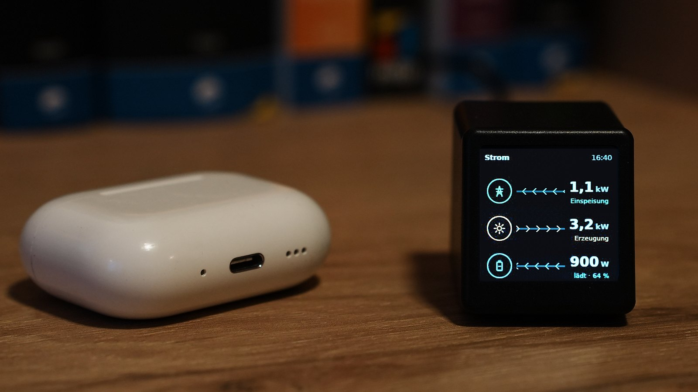
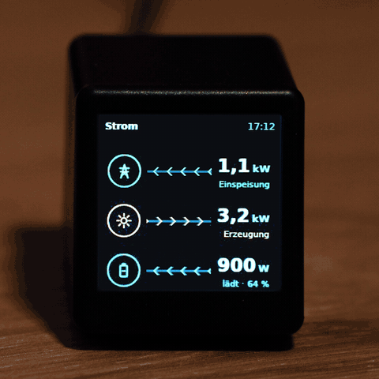
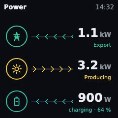
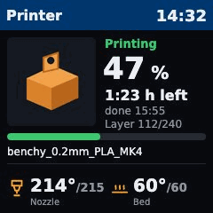
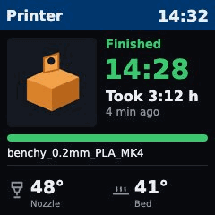

**English version: [README.md](README.md)**

# Glance Box

[](https://github.com/robinlanger/glancebox/releases/latest)
[](https://github.com/robinlanger/glancebox/actions/workflows/ci.yml)
[](LICENSE)

**Website mit Schritt-für-Schritt-Anleitung: [robinlanger.github.io/glancebox/de](https://robinlanger.github.io/glancebox/de/)**



**Glance Box macht aus dem GeekMagic SmallTV Ultra für ca. 15 € ein WLAN-Display mit 240x240 Pixeln für alles, was du als HTML schreiben kannst:** eine Open-Source-Firmware für das Display und ein kleiner Docker-Server, der deine Seiten rendert und als Bilder ans Display schickt. Abfahrten, eine Uhr, das Wetter, den Zustand deines Heimservers, wie viel von deinem KI-Abo noch übrig ist, Live-Werte aus deinem Home Assistant, von der Solarleistung bis zum offenen Fenster, den Energiefluss in deinem Zuhause mit laufenden Pfeilen, alles, was auf 240x240 Pixel passt.

> [!TIP]
> **Kein Löten nötig.** Du flashst Glance Box über das Menü **„Firmware update“** der Original-Firmware, im Browser. Kein Gehäuse öffnen, keine Kabel.

## Neu in 0.7.0: Energiefluss live



Die neue Seite [`energy`](docs/de/templates/energy.md) zeigt, wohin in deinem Zuhause Energie fließt, aus Home Assistant: Netz, PV, Speicher, Gas, Wasser oder Wallbox, bis zu vier Zeilen pro Seite. Die Pfeile bewegt das Display selbst, in Flussrichtung und umso schneller, je mehr fließt. Der Server schickt nur dann ein neues Bild, wenn sich ein Wert ändert.

Der Clip zeigt das echte Display, mit einer Kamera gefilmt. Nachträglich ist nur das Schwarz des Bildschirms abgedunkelt: Je nach Blickwinkel wirkt dieses Panel auf der Kamera blaugrau.

<br clear="right">

## Highlights

- **Seiten sind einfach HTML.** Schreib eine Seite als Vorlage oder richte den Server auf irgendeine Webseite. Der Server rendert sie mit Headless-Chromium, derselben Engine wie in Chrome.
- **Fertige Vorlagen** für Wetter, Uptime Kuma, Home Assistant, den Energiefluss mit laufenden Pfeilen, einen 3D-Drucker (Moonraker, OctoPrint, PrusaLink oder Home Assistant), KI-Nutzung (Claude, OpenAI, xAI, GitHub Copilot), Abfahrten und eine Uhr. Du trägst sie nur in die `config.yaml` ein.
- **Offene Firmware für den ESP8266**: WLAN-Einrichtungsportal, eine kleine Einstellungsseite, Nachtmodus mit eigener Helligkeit (oder Hintergrundbeleuchtung aus).
- **Sichere Updates über WLAN**: passwortgeschützt, jedes Abbild wird gegen seine MD5 geprüft. Eine falsche Datei wird abgelehnt, und die alte Firmware läuft weiter. Nach einem kaputten Update startet das Gerät im Safe Mode statt in einer Boot-Schleife.
- **Läuft in Docker** auf einem PC, NAS oder Homeserver. Das Display zeigt nur Bilder an; die ganze Arbeit macht der Server.
- **MIT-Lizenz**, keine Cloud, kein Konto. Das Display spricht nur mit deinem eigenen Server.

Am echten SmallTV Ultra getestet: erstes Flashen über das Menü „Firmware update“ der Original-Firmware, OTA-Updates mit MD5-Prüfung, Safe Mode nach einem kaputten Update, Nachtmodus sowie die Seiten für Abfahrten, Uhr, Wetter, Uptime Kuma, Claude-Limits und den Energiefluss.

## Galerie

Auf dem echten Display: Abfahrten, Uptime Kuma, Wetter und Claude-Limits.


Alle eingebauten Seiten:

<table>
<tr>
<td width="33%" valign="top"><b><code>bahn</code>: Live-Abfahrten</b><br><br>Verspätungen, Gleiswechsel und Ausfälle für deutsche Bahnhöfe.</td>
<td width="33%" valign="top"><b><code>clock</code>: Uhr und Datum</b><br><br>Große Uhr mit Wochentag und Datum. Ein guter Start für eigene Seiten.</td>
<td width="33%" valign="top"><b><code>weather</code>: Vorhersage</b><br><br>Jetzt, Tageshoch und -tief und die nächsten vier Stunden, von Open-Meteo.</td>
</tr>
<tr>
<td width="33%" valign="top"><b><code>kuma</code>: Uptime Kuma</b><br><br>Alles grün, oder welche Dienste seit wann ausgefallen sind.</td>
<td width="33%" valign="top"><b><code>ai</code>: Claude-Limits</b><br><br>5-Stunden- und Wochenlimit deines Claude-Abos.</td>
<td width="33%" valign="top"><b><code>ai</code>: API-Kosten</b><br><br>Monatskosten oder Guthaben der API von Anthropic, OpenAI oder xAI, oder deine GitHub-Copilot-Nutzung.</td>
</tr>
<tr>
<td width="33%" valign="top"><b><code>homeassistant</code>: Kacheln</b><br><br>Bis zu vier große Werte, zum Beispiel Solarleistung und Akku.</td>
<td width="33%" valign="top"><b><code>homeassistant</code>: Liste</b><br><br>Bis zu sechs Zeilen: Temperaturen, Türen, Fenster, Lichter.</td>
<td width="33%" valign="top"><b><code>energy</code>: Energiefluss</b><br><br>Netz, PV, Speicher, Gas, Wasser oder Wallbox, mit Pfeilen, die das Display in Richtung des Flusses bewegt (ab Firmware 0.7.0; hier eine feste Stellung).</td>
</tr>
<tr>
<td width="33%" valign="top"><b><code>printer</code>: Druckt</b><br><br>Fortschritt, Restzeit, Fertig-Uhrzeit, Schicht, Slicer-Vorschaubild, Düse und Bett, von Moonraker, OctoPrint, PrusaLink oder Home Assistant. An einem echten Drucker nur über Moonraker (Klipper) geprüft.</td>
<td width="33%" valign="top"><b><code>printer</code>: Fertig</b><br><br>Ende, Dauer und wie lange her; nach <code>finished_for</code> Minuten zeigt die Seite Bereit.</td>
</tr>
</table>

Die Bilder sind 240x240-Frames, die der Server mit Beispieldaten rendert, genau so, wie das Display sie bekommt. Alle Vorlagen mit allen Optionen stehen im [Vorlagenkatalog](docs/de/templates/README.md). Der Seitentyp `url` zeigt jede Webseite, auf die du ihn richtest. Willst du die Original-Firmware behalten, passt [geekmagic-hacs](https://github.com/adrienbrault/geekmagic-hacs) besser: eine Home-Assistant-Integration, die das Display mit seiner Original-Firmware ansteuert.

## So funktioniert es

```
config.yaml ──▶ Glance-Box-Server (Docker) ──JPEG über HTTP──▶ Glance-Box-Firmware (SmallTV Ultra)
                 rendert deine Seiten
                 mit Headless-Chromium
```

- **Firmware** (Open Source, ESP8266): holt das nächste Bild von deinem Server, zeigt es an und fragt wieder, wenn der Server es sagt.
- **Server** (Docker): rendert deine Seiten nach einer Playlist zu kleinen JPEG-Bildern (240x240, höchstens 24 KB) und liefert sie ans Display. Schlägt eine Seite fehl, schickt der Server noch eine Weile das letzte gute Bild und danach ein Bild mit dem Fehler statt eines schwarzen Bildschirms.

## Was du brauchst

- Einen **GeekMagic SmallTV Ultra** (Version mit ESP8266). Der SmallTV Pro (ESP32) und andere Modelle werden **nicht** unterstützt.
- Einen Computer oder kleinen Server im Heimnetz, auf dem Docker läuft. Das Image wird für amd64 und arm64 gebaut; der Maintainer hat es bisher auf amd64 getestet, arm64 (zum Beispiel ein Raspberry Pi 4) ist noch nicht getestet.
- Ein 2,4-GHz-WLAN. Server und Display müssen im selben Netzwerk sein.
- Optional: einen USB-Seriell-Adapter und einen Lötkolben oder Prüfklemmen, nur wenn du die Original-Firmware sichern willst (siehe nächster Abschnitt).

## Vor dem Flashen: eine Entscheidung ohne Rückweg

> [!WARNING]
> **Ohne vorherige serielle Sicherung ist das Flashen von Glance Box eine Einbahnstraße.** Die Original-Firmware ist an dein Gerät gebunden (der Aktivierungscode hängt an der MAC-Adresse), und niemand stellt ein Abbild bereit, das du stattdessen aufspielen könntest. Ohne Sicherung gibt es keinen Weg zurück zur Original-Firmware.

Entscheide vor dem ersten Flashen:

- **Ohne Sicherung flashen** (kein Löten): Du nimmst in Kauf, dass das Gerät bei der offenen Firmware bleibt. Glance Box selbst aktualisierst du über WLAN; falls das einmal scheitert, beschreibt [docs/de/recovery.md](docs/de/recovery.md) den Safe Mode und den seriellen Weg.
- **Erst seriell sichern**: Gehäuse öffnen, einen USB-Seriell-Adapter mit 3,3 V an das ESP-12F-Modul anschließen, den Flash-Speicher zweimal auslesen und vergleichen. Wie das geht, steht in [docs/de/flashing.md](docs/de/flashing.md).

Beim Flashen wird die Firmware deines Geräts ersetzt. Das machst du auf eigene Gefahr. Das Projekt kommt ohne jede Gewährleistung (MIT-Lizenz).

## Schnellstart

1. **Server starten.**

   ```sh
   git clone https://github.com/robinlanger/glancebox.git
   cd glancebox
   cp config-example.yaml config.yaml
   mkdir pages-custom
   ```

   Öffne `config.yaml` und passe die Seiten an (mindestens den Bahnhof der `bahn`-Seite, oder entferne die Seite; entferne oder ändere die `url`-Seite). Dann:

   ```sh
   docker compose up -d --build
   ```

   Öffne `http://<server-ip>:8080/` im Browser. Du solltest eine Vorschau jeder Seite sehen. Mehr dazu: [docs/de/configuration.md](docs/de/configuration.md).

2. **Firmware herunterladen.** Hol dir `glancebox-ultra-<version>.bin` und die zugehörige `.md5`-Datei von der [Releases-Seite](https://github.com/robinlanger/glancebox/releases).

3. **Über die Original-Weboberfläche flashen.** Öffne `http://<display-ip>/`, geh zu **„Firmware update“**, lade die `.bin` hoch und warte etwa eine Minute. Schritt für Schritt: [docs/de/flashing.md](docs/de/flashing.md).

4. **Einrichten.** Verbinde dich mit dem WLAN `GlanceBox-XXXX`, wähle dein Netzwerk, gib die Serveradresse und ein Update-Passwort ein: [docs/de/setup.md](docs/de/setup.md). Das Display startet neu und zeigt deine erste Seite.

**Home Assistant OS?** Statt Schritt 1 läuft der Server auch als Add-on: [docs/de/home-assistant.md](docs/de/home-assistant.md).

## Dokumentation

| Thema | English | Deutsch |
| --- | --- | --- |
| Erstes Flashen, Sicherung | [flashing.md](docs/en/flashing.md) | [flashing.md](docs/de/flashing.md) |
| WLAN-Einrichtung, Passwort | [setup.md](docs/en/setup.md) | [setup.md](docs/de/setup.md) |
| Server-Konfiguration | [configuration.md](docs/en/configuration.md) | [configuration.md](docs/de/configuration.md) |
| Home-Assistant-Add-on | [home-assistant.md](docs/en/home-assistant.md) | [home-assistant.md](docs/de/home-assistant.md) |
| Vorlagen-Katalog (Seiten mit Vorschau) | [README.md](docs/en/templates/README.md) | [README.md](docs/de/templates/README.md) |
| Eigene Seiten schreiben | [writing-pages.md](docs/en/writing-pages.md) | [writing-pages.md](docs/de/writing-pages.md) |
| Firmware aktualisieren | [updating.md](docs/en/updating.md) | [updating.md](docs/de/updating.md) |
| Safe Mode, serielle Rettung | [recovery.md](docs/en/recovery.md) | [recovery.md](docs/de/recovery.md) |

Für Maintainer: [docs/RELEASING.md](docs/RELEASING.md) (nur Englisch). Änderungen je Version: [CHANGELOG.md](CHANGELOG.md).

## Aus dem Quellcode bauen

Die meisten brauchen das nie: Auf der Releases-Seite liegt die fertige Firmware, und das Server-Image baut `docker compose up --build` selbst. Releases veröffentlichen außerdem das Image `ghcr.io/robinlanger/glancebox:<version>`.

- Server: `python -m glancebox serve` im Ordner `server/` (Python 3.12, siehe `server/pyproject.toml`) oder `docker compose build`.
- Firmware: [PlatformIO](https://platformio.org/) installieren und in `firmware/` `pio run -e ultra` ausführen. Auf einem **Mac mit Apple Silicon** gibt es die ESP8266-Toolchain nur für x86. Du brauchst also Rosetta oder baust in einem Docker-Container.

## Danksagung

- **[DBF / db-infoscreen](https://dbf.finalrewind.org)** von derf liefert die Abfahrtsdaten für die `bahn`-Seite. Bitte geh sorgsam mit diesem kostenlosen Dienst um; die Seite hält sich an seine Regel von höchstens einer Anfrage pro Bahnhof und Minute.
- **[Open-Meteo](https://open-meteo.com)** liefert die Wetterdaten für die `weather`-Seite (CC BY 4.0). Bitte geh sorgsam mit diesem kostenlosen Dienst um; die Seite fragt höchstens alle 15 Minuten an.
- Die **ESPHome-Community** hat die Pinbelegung der SmallTV-Displays herausgefunden (SPI-Pins, Hintergrundbeleuchtung, kein Chip-Select). Erst dadurch wurde eine offene Firmware möglich.
- **[TJpgDec](http://elm-chan.org/fsw/tjpgd/)** von ChaN (mitgeliefert, sein Lizenzkopf bleibt erhalten) dekodiert die JPEG-Bilder auf dem Gerät.
- **[TFT_eSPI](https://github.com/Bodmer/TFT_eSPI)** von Bodmer steuert das Display an.
- **[WiFiManager](https://github.com/tzapu/WiFiManager)** von tzapu liefert das WLAN-Einrichtungsportal.
- Die DejaVu-Schriften (im Server enthalten, Lizenz in `server/glancebox/fonts/`).

## Lizenz

MIT, siehe [LICENSE](LICENSE).
