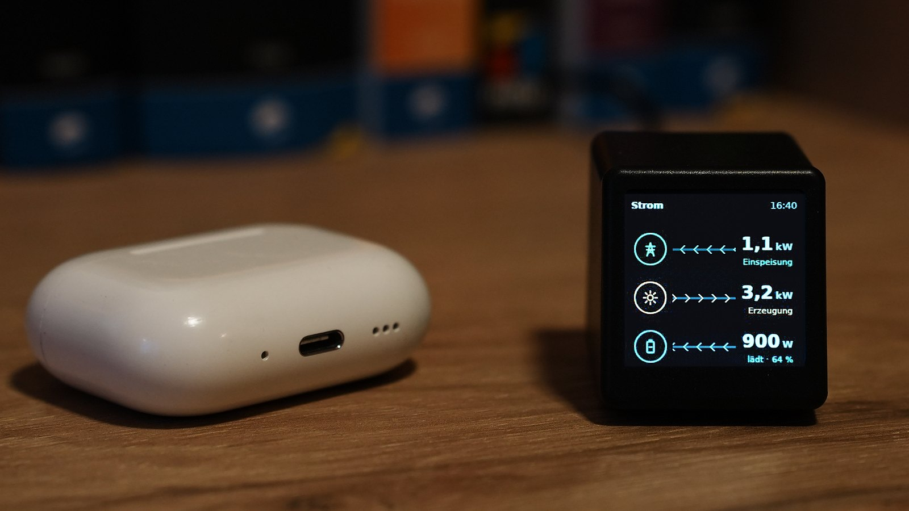
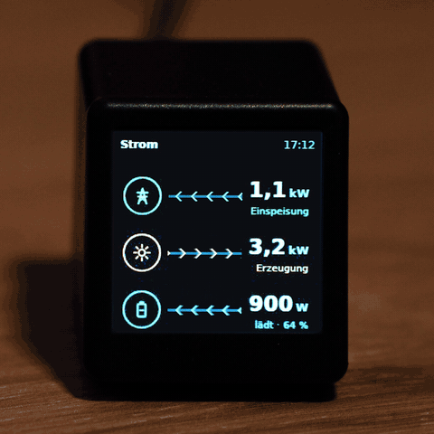

**Deutsche Version: [README.de.md](README.de.md)**

# Glance Box

[](https://github.com/robinlanger/glancebox/releases/latest)
[](https://github.com/robinlanger/glancebox/actions/workflows/ci.yml)
[](LICENSE)

**Website with a step-by-step guide: [robinlanger.github.io/glancebox](https://robinlanger.github.io/glancebox/)**



**Glance Box turns the ~15 € GeekMagic SmallTV Ultra into a 240x240 Wi-Fi display for anything you can write as HTML:** open-source firmware for the display, plus a small Docker server that renders your pages and sends them over as images. Departures, a clock, the weather, the state of your home server, how much of your AI plan is left, live values from your Home Assistant, from solar power to open windows, the energy flow of your home with moving arrows, whatever fits on 240x240 pixels.

> [!TIP]
> **No soldering needed.** You flash Glance Box through the **"Firmware update"** menu of the stock firmware, in your browser. No case to open, no wires.

## New in 0.7.0: live energy flow



The new [`energy`](docs/en/templates/energy.md) page shows where energy flows in your home, from Home Assistant: grid, PV, battery, gas, water or wallbox, up to four rows per page. The display moves the arrows itself, in the direction of the flow and faster the more flows, while the server sends a new picture only when a value changes.

The clip is the real display, filmed with a camera. Only the black of the screen was darkened afterwards: depending on the viewing angle, this panel looks blue-grey on camera.

<br clear="right">

## Highlights

- **Pages are just HTML.** Write a page as a template, or point the server at any web page. The server renders it with headless Chromium, the same engine as in Chrome.
- **Ready-made templates** for the weather, Uptime Kuma, Home Assistant, the energy flow with moving arrows, AI usage (Claude, OpenAI, xAI, GitHub Copilot), departures and a clock. You only add them to `config.yaml`.
- **Open firmware for the ESP8266**: Wi-Fi setup portal, a small settings page, night mode with its own brightness (or backlight off).
- **Safe updates over Wi-Fi**: password-protected, every image is checked against its MD5. A wrong file is rejected and the old firmware keeps running. After a broken update the device starts in safe mode instead of a boot loop.
- **Runs in Docker** on a PC, NAS or home server. The display only shows pictures; all the work happens on the server.
- **MIT licensed**, no cloud, no account. The display only talks to your own server.

Tested on a real SmallTV Ultra: first flash through the stock "Firmware update" menu, OTA updates with MD5 check, safe mode after a broken update, night mode, and the pages for departures, clock, weather, Uptime Kuma, Claude limits and the energy flow.

## Gallery

On the real display: departures, Uptime Kuma, weather and Claude limits.


All built-in pages:

<table>
<tr>
<td width="33%" valign="top"><b><code>bahn</code>: live departures</b><br><br>Delays, platform changes and cancellations for German stations.</td>
<td width="33%" valign="top"><b><code>clock</code>: clock and date</b><br><br>Large clock with weekday and date. A good start for your own pages.</td>
<td width="33%" valign="top"><b><code>weather</code>: forecast</b><br><br>Now, today's high and low and the next four hours, from Open-Meteo.</td>
</tr>
<tr>
<td width="33%" valign="top"><b><code>kuma</code>: Uptime Kuma</b><br><br>All green, or which services are down and since when.</td>
<td width="33%" valign="top"><b><code>ai</code>: Claude limits</b><br><br>5-hour and weekly limits of your Claude plan.</td>
<td width="33%" valign="top"><b><code>ai</code>: API cost</b><br><br>Monthly cost or balance of the Anthropic, OpenAI or xAI API, or your GitHub Copilot usage.</td>
</tr>
<tr>
<td width="33%" valign="top"><b><code>homeassistant</code>: tiles</b><br><br>Up to four large values, for example solar power and battery.</td>
<td width="33%" valign="top"><b><code>homeassistant</code>: list</b><br><br>Up to six rows: temperatures, doors, windows, lights.</td>
<td width="33%" valign="top"><b><code>energy</code>: energy flow</b><br><br>Grid, PV, battery, gas, water or wallbox, with arrows the display moves in the direction of the flow (firmware 0.7.0 or newer; here one still position).</td>
</tr>
</table>

The pictures are 240x240 frames rendered by the server with sample data, exactly as the display gets them. Every template, with all options, is in the [template catalog](docs/en/templates/README.md). The `url` page type shows any web page you point it at. If you want to keep the stock firmware, [geekmagic-hacs](https://github.com/adrienbrault/geekmagic-hacs) is the better fit: a Home Assistant integration that drives the display with its original firmware. Write your own pages with [docs/en/writing-pages.md](docs/en/writing-pages.md).

## How it works

```
config.yaml ──▶ Glance Box server (Docker) ──JPEG over HTTP──▶ Glance Box firmware (SmallTV Ultra)
                 renders your pages
                 with headless Chromium
```

- **Firmware** (open source, ESP8266): fetches the next frame from your server, shows it, and asks again when the server says so.
- **Server** (Docker): renders your pages on a playlist to small JPEG images (240x240, at most 24 KB) and serves them to the display. If a page fails, the server keeps sending the last good picture for a while, then a picture with the error instead of a black screen.

## What you need

- A **GeekMagic SmallTV Ultra** (ESP8266 version). The SmallTV Pro (ESP32) and other models are **not** supported.
- A computer or small server in your home network that runs Docker. The image is built for amd64 and arm64; the maintainer has tested it on amd64 so far, arm64 (for example a Raspberry Pi 4) is not tested yet.
- A 2.4 GHz Wi-Fi network. The server and the display must be in the same network.
- Optional: a USB-to-serial adapter and a soldering iron or clip leads, only if you want a backup of the stock firmware (see the next section).

## Before you flash: a one-way decision

> [!WARNING]
> **Flashing Glance Box is a one-way street unless you make a serial backup first.** The stock firmware is tied to your device (the activation code is bound to the MAC address), and nobody offers an image you could flash instead. Without a backup there is no way back to the stock firmware.

Decide before the first flash:

- **Flash without a backup** (no soldering): you accept that the device stays on open firmware. Glance Box itself is updated over Wi-Fi; if that ever fails, [docs/en/recovery.md](docs/en/recovery.md) describes safe mode and the serial way.
- **Make a serial backup first**: open the case, connect a 3.3 V USB-to-serial adapter to the ESP-12F module, read the flash twice and compare. [docs/en/flashing.md](docs/en/flashing.md) shows how.

Flashing replaces the firmware on your device. You do this at your own risk. The project comes without any warranty (MIT license).

## Quickstart

1. **Start the server.**

   ```sh
   git clone https://github.com/robinlanger/glancebox.git
   cd glancebox
   cp config-example.yaml config.yaml
   mkdir pages-custom
   ```

   Open `config.yaml` and adjust the pages (at least the station of the `bahn` page, or remove the page; remove or change the `url` page). Then:

   ```sh
   docker compose up -d --build
   ```

   Open `http://<server-ip>:8080/` in your browser. You should see a preview of every page. Details: [docs/en/configuration.md](docs/en/configuration.md).

2. **Download the firmware.** Get `glancebox-ultra-<version>.bin` and its `.md5` file from the [releases page](https://github.com/robinlanger/glancebox/releases).

3. **Flash it through the stock web interface.** Open `http://<display-ip>/`, go to **"Firmware update"**, upload the `.bin` and wait about a minute. Step by step: [docs/en/flashing.md](docs/en/flashing.md).

4. **Set it up.** Join the `GlanceBox-XXXX` Wi-Fi, choose your network, enter the server address and an update password: [docs/en/setup.md](docs/en/setup.md). The display restarts and shows your first page.

**Home Assistant OS?** Run the server as an add-on instead of step 1: [docs/en/home-assistant.md](docs/en/home-assistant.md).

## Documentation

| Topic | English | Deutsch |
| --- | --- | --- |
| First flash, backup | [flashing.md](docs/en/flashing.md) | [flashing.md](docs/de/flashing.md) |
| Wi-Fi setup, password | [setup.md](docs/en/setup.md) | [setup.md](docs/de/setup.md) |
| Server configuration | [configuration.md](docs/en/configuration.md) | [configuration.md](docs/de/configuration.md) |
| Home Assistant add-on | [home-assistant.md](docs/en/home-assistant.md) | [home-assistant.md](docs/de/home-assistant.md) |
| Template catalog (pages with previews) | [README.md](docs/en/templates/README.md) | [README.md](docs/de/templates/README.md) |
| Writing your own pages | [writing-pages.md](docs/en/writing-pages.md) | [writing-pages.md](docs/de/writing-pages.md) |
| Updating the firmware | [updating.md](docs/en/updating.md) | [updating.md](docs/de/updating.md) |
| Safe mode, serial recovery | [recovery.md](docs/en/recovery.md) | [recovery.md](docs/de/recovery.md) |

Maintainers: [docs/RELEASING.md](docs/RELEASING.md) (English only). Changes per version: [CHANGELOG.md](CHANGELOG.md).

## Building from source

Most people never need this: the release page has the ready-made firmware, and the server image is built by `docker compose up --build`. Releases also publish the image `ghcr.io/robinlanger/glancebox:<version>`.

- Server: `python -m glancebox serve` from `server/` (Python 3.12, see `server/pyproject.toml`), or `docker compose build`.
- Firmware: install [PlatformIO](https://platformio.org/) and run `pio run -e ultra` in `firmware/`. On an **Apple Silicon Mac** the ESP8266 toolchain is x86-only, so you need Rosetta or you build inside a Docker container.

## Credits

- **[DBF / db-infoscreen](https://dbf.finalrewind.org)** by derf provides the departure data for the `bahn` page. Please be kind to this free service; the page respects its rule of at most one request per station and minute.
- **[Open-Meteo](https://open-meteo.com)** provides the weather data for the `weather` page (CC BY 4.0). Please be kind to this free service; the page asks at most every 15 minutes.
- The **ESPHome community** worked out the pinout of the SmallTV displays (SPI pins, backlight, no chip-select), which made an open firmware possible.
- **[TJpgDec](http://elm-chan.org/fsw/tjpgd/)** by ChaN (vendored, its license header is kept) decodes the JPEG frames on the device.
- **[TFT_eSPI](https://github.com/Bodmer/TFT_eSPI)** by Bodmer drives the display.
- **[WiFiManager](https://github.com/tzapu/WiFiManager)** by tzapu provides the Wi-Fi setup portal.
- The DejaVu fonts (bundled with the server, license in `server/glancebox/fonts/`).

## License

MIT, see [LICENSE](LICENSE).
