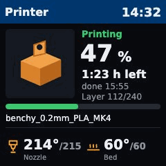

# Vorlagen-Katalog

Fertige Seiten für das Display. Jede hat eine eigene Seite mit Beispielbild, allen Optionen, Einrichtung und Hinweisen zum Datenschutz. Trage eine Seite in die Liste `pages:` der `config.yaml` ein und starte den Server neu, siehe [Server-Konfiguration](../configuration.md).

## Zeit & Wetter

### clock

Große Uhr mit Wochentag und Datum, zugleich der Ausgangspunkt für eigene Seiten. [Details](clock.md)

### weather

Aktuelles Wetter und die nächsten vier Stunden für einen Ort, vom kostenlosen Dienst Open-Meteo. [Details](weather.md)

## Server & Smart Home

### kuma

Zustand einer Uptime-Kuma-Statusseite: alles grün, oder welche Dienste seit wann gestört sind. [Details](kuma.md)

### homeassistant

Live-Werte von bis zu sechs Home-Assistant-Entitäten als große Kacheln oder Liste: Solarleistung, Temperaturen, offene Fenster, Lichter. Braucht einen langlebigen Zugangstoken. [Details](homeassistant.md)

### energy

Energiefluss aus Home Assistant in bis zu vier Zeilen (Netz, PV, Speicher, Gas, Wasser, Wallbox), mit Pfeilen, die auf dem Display in Richtung des Flusses laufen (Firmware 0.7.0 oder neuer). [Details](energy.md)

## 3D-Druck

### printer

Zustand, Fortschritt, Restzeit, Fertig-Uhrzeit, Slicer-Vorschaubild und Temperaturen eines 3D-Druckers, direkt von Moonraker (Klipper), OctoPrint oder PrusaLink oder über Home Assistant (auch Bambu Lab und Creality). Noch nicht an einem echten Drucker geprüft. [Details](printer.md)

## KI & Entwicklung

### ai

Wie viel von deinem KI-Abo oder -Budget verbraucht ist. Anbieter `claude`: das 5-Stunden- und das Wochenlimit deines Claude-Abos, geschickt von der Statuszeile von Claude Code. `anthropic-api`, `openai-api`, `xai-api`: API-Kosten des Monats oder das Prepaid-Guthaben. `copilot`: Verbrauch von GitHub Copilot gegen das Kontingent deines Abos. [Details](ai.md)

## Verkehr

### bahn

Live-Abfahrten für einen deutschen Bahnhof mit Verspätungen, Gleiswechseln und Ausfällen. [Details](bahn.md)

## Eigene Seiten

Eine Seite besteht aus einem Ordner mit einer kleinen Python-Datei und einer Jinja-Vorlage. [Eigene Seiten schreiben](../writing-pages.md) führt Schritt für Schritt durch.
