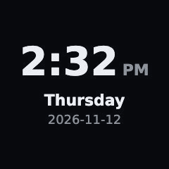

# clock




Mit `time_format: 12h`

## Was sie zeigt

Die Uhrzeit in großen Ziffern, darunter Wochentag und Datum. Es ist die kleinste sinnvolle Seite und der Ausgangspunkt für eigene Seiten.

## Was du brauchst

Nichts. Die Seite braucht keinen Netzwerkzugriff, kein Konto und keinen Schlüssel.

## Beispiel

```yaml
- type: clock
  lang: de
  refresh: 60
```

## Optionen

| Schlüssel | Standard | Bedeutung |
| --- | --- | --- |
| `lang` | oberstes `lang` | `de` oder `en`. Bestimmt die Sprache des Wochentags und das Datumsformat (`14.11.2026` oder `2026-11-14`). |
| `duration` | `interval` | Wie viele Sekunden die Seite auf dem Display bleibt. |
| `refresh` | `duration` | Wie oft die Seite neu gerendert wird. Einmal pro Minute (`60`) genügt. |
| `time_format` | oberstes `time_format` | `24h` oder `12h`. Bei `12h` steht die Zeit als `2:32` mit kleinem `PM` daneben. Die Ziffern sind dort kleiner (56 statt 72 px), damit AM/PM passt. |

`duration`, `refresh` und `time_format` gelten für jede Seite, siehe [Server-Konfiguration](../configuration.md#optionen-die-jede-seite-hat). Die Zeitzone kommt aus `timezone` auf oberster Ebene.

## Einrichtung

1. Füge das Beispiel oben in die Liste `pages:` der `config.yaml` ein.
2. Starte den Server neu: `docker compose restart`.
3. Öffne `http://<server>:8080/` und prüfe die Vorschau.

Um daraus eine eigene Seite zu bauen, kopiere `pages/clock` nach `pages-custom/meineseite` und passe sie an, wie in [Eigene Seiten schreiben](../writing-pages.md) beschrieben.

## Datenschutz & Sicherheit

Die Seite stellt keine Netzwerkanfragen und speichert nichts. Sie liest nur die Uhr des Servers.

## Wenn etwas nicht stimmt

- **Die Uhrzeit ist um eine Stunde verschoben:** Setze `timezone` auf oberster Ebene (zum Beispiel `Europe/Berlin`). Standard ist `Europe/Berlin`.
- **Der Wochentag hat die falsche Sprache:** Setze `lang: en` oder `lang: de` an der Seite oder `lang` auf oberster Ebene.
- **Der Server startet nicht und meldet `lang must be 'de' or 'en'`:** Es gibt nur diese beiden Werte.
