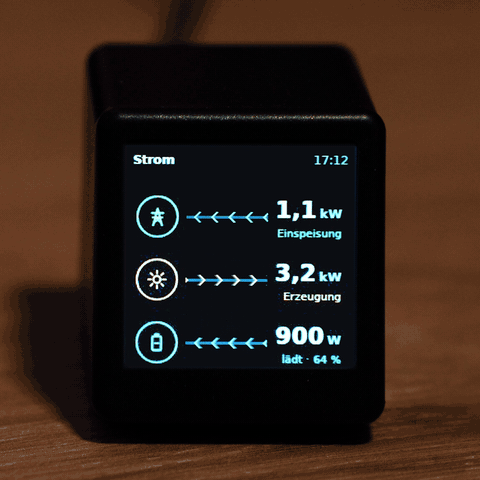

# energy


Auf dem echten Display, mit einer Kamera gefilmt (nachträglich nur das Schwarz des Bildschirms abgedunkelt):

{ width="360" }

## Was sie zeigt

Den Energiefluss in deinem Zuhause, aus [Home Assistant](https://www.home-assistant.io/): eine bis vier Zeilen, jede mit Symbol, einer Spur mit laufenden Pfeilen, dem Wert und einer kurzen Statuszeile. Typisch sind Netz, PV und Speicher auf einer Seite, Gas, Wasser und Wallbox auf einer zweiten. Du kannst beliebig viele `energy`-Seiten anlegen.

Die Pfeile zeigen, wohin es fließt:

| Pfeile | Bedeutung | Zeilen |
| --- | --- | --- |
| vom Symbol weg (nach rechts) | diese Quelle liefert ins Haus | Netzbezug, PV, Speicher entlädt, Gas, Wasser |
| zum Symbol hin (nach links) | diese Zeile nimmt Energie auf | Einspeisung, Speicher lädt, Wallbox |
| keine, Spur und Wert grau | es fließt nichts | Wert 0, unter `min`, `n. v.` oder `fehlt` |

Je mehr Leistung oder Durchfluss, desto schneller die Pfeile: von 10 px/s bei kleinen Werten bis 80 px/s ab dem Wert `full` der Zeile. Der Wert steht ohne Vorzeichen da; Richtung, Farbe und Statuszeile (`Bezug`, `Einspeisung`, `Erzeugung`, `lädt`, `entlädt`, `Verbrauch`) sagen, wohin es geht. Mit einem `soc`-Sensor zeigt die Speicherzeile auch den Ladestand, zum Beispiel `lädt · 64 %`.

Jeder Zeilentyp erwartet seinen Sensor in dieser Form:

| `type` | Sensor | Vorzeichen | Standard für `full` |
| --- | --- | --- | --- |
| `grid` | Leistung, W oder kW | positiv = Bezug aus dem Netz, negativ = Einspeisung ins Netz | 5000 W |
| `pv` | Leistung, W oder kW | positiv = Erzeugung; negativ gilt als 0 | 5000 W |
| `battery` | Leistung, W oder kW | positiv = Speicher entlädt, negativ = Speicher lädt (wie im Energie-Dashboard von Home Assistant) | 3000 W |
| `gas` | Durchfluss, zum Beispiel m³/h | positiv = Verbrauch; negativ gilt als 0 | 2 (Einheit des Sensors) |
| `water` | Durchfluss, zum Beispiel L/min | positiv = Verbrauch; negativ gilt als 0 | 15 (Einheit des Sensors) |
| `wallbox` | Leistung, W oder kW | positiv = Auto lädt; negativ gilt als 0 | 11000 W |

Meldet dein Sensor andersherum, dreht `invert: true` das Vorzeichen. Werte in W ab 1000 erscheinen als kW. Wie bei der Seite `homeassistant` zeigt ein Sensor, der `unavailable` oder `unknown` ist, `n. v.`, ein Sensor, den es nicht gibt, `fehlt`, und ohne Verbindung zeigt die Seite `Keine Verbindung zu Home Assistant` mit der Uhrzeit des letzten Versuchs, nie alte Werte.

Ehrliche Hinweise:

- Leistungssensoren melden meist etwa jede Sekunde. **Gas- und Wasserzähler melden oft nur Impulse oder alle paar Minuten**, ihre Pfeile reagieren entsprechend spät.
- Die Seite braucht einen Sensor für den **Durchfluss oder die Leistung**, nicht den Zählerstand. Hast du nur einen Zählerstand (m³, kWh), lege in Home Assistant einen **Ableitungs**-Helfer an (Einstellungen → Geräte & Dienste → Helfer) und nimm diesen.
- Vom Sensor bis zum Display dauert es mehrere Sekunden (Home Assistant, das `refresh` des Servers, der Abruf des Displays). Die Pfeile zeigen Richtung und Größenordnung, nicht jede kurze Spitze.
- **Die Pfeile laufen ab Firmware 0.7.0.** Mit älterer Firmware erscheint die Seite als Standbild mit leeren Spuren. Die Vorschau im Browser (Übersichtsseite, Weboberfläche des Add-ons) ist immer ein Standbild.

## Was du brauchst

- Ein laufendes Home Assistant, das der Glance-Box-Server über das Netzwerk erreicht, und einen langlebigen Zugangstoken, eingerichtet wie bei der [Seite homeassistant](homeassistant.md#was-du-brauchst). Im [Home-Assistant-Add-on](../home-assistant.md) brauchst du beides nicht.
- Die Entity-IDs deiner Leistungs- und Durchflusssensoren, zum Beispiel `sensor.grid_power`. Du findest sie in Home Assistant unter **Einstellungen → Geräte & Dienste → Entitäten**. Die Sensoren des Energie-Dashboards (Einstellungen → Dashboards → Energie) sind ein guter Anfang.
- Für die Pfeile: das Display (GeekMagic SmallTV Ultra) mit Firmware 0.7.0 oder neuer. Die Version steht oben auf der Geräteseite.

Noch keine Sensoren, oder willst du die Pfeile erst ausprobieren? Das [simulierte Home Assistant](https://github.com/robinlanger/glancebox/tree/main/tools/ha-sim) im Repository hat Schein-Sensoren für Energie mit Schiebereglern (`tools/ha-sim/config/packages/energy.yaml`, läuft in jedem Home Assistant mit Packages).

## Beispiel

Netz, PV und Speicher:

```yaml
- type: energy
  url: ${HA_URL}              # im Add-on weglassen
  token: ${HA_TOKEN}          # im Add-on weglassen
  title: Strom
  refresh: 5
  rows:
    - type: grid
      entity: sensor.grid_power
      # invert: true          # wenn dein Zähler Einspeisung positiv meldet
      # full: 5000            # Wert für volles Tempo
      # min: 20               # darunter gilt die Zeile als 0
    - type: pv
      entity: sensor.pv_power
    - type: battery
      entity: sensor.battery_power
      soc: sensor.battery_level   # optional, Ladestand in %
```

Gas, Wasser und Wallbox auf einer zweiten Seite:

```yaml
- type: energy
  url: ${HA_URL}
  token: ${HA_TOKEN}
  title: Haus
  refresh: 5
  rows:
    - type: gas
      entity: sensor.gas_flow
    - type: water
      entity: sensor.water_flow
    - type: wallbox
      entity: sensor.wallbox_power
```

## Optionen

| Schlüssel | Standard | Bedeutung |
| --- | --- | --- |
| `url` | | Adresse deines Home Assistant, beginnt mit `http://` oder `https://`, ohne `/api`. Pflicht, außer im Add-on. Am besten als `${HA_URL}` aus der `.env`. |
| `token` | | Langlebiger Zugangstoken. Pflicht, außer im Add-on. Immer als `${HA_TOKEN}` aus der `.env`, nie direkt in die `config.yaml`. |
| `rows` | | Liste mit 1 bis 4 Zeilen. Pflicht. Derselbe Typ darf mehrfach vorkommen (zwei PV-Anlagen). |
| `rows[].type` | | `grid`, `pv`, `battery`, `gas`, `water` oder `wallbox`. Pflicht. |
| `rows[].entity` | | Entity-ID des Leistungs- oder Durchflusssensors, etwa `sensor.grid_power`. Pflicht. |
| `rows[].soc` | | Nur bei `battery`: Entity-ID des Ladestands in %. Erscheint in der Statuszeile. |
| `rows[].invert` | `false` | `true` dreht das Vorzeichen des Sensors. |
| `rows[].full` | siehe Tabelle der Zeilentypen | Wert, bei dem die Pfeile volles Tempo erreichen. In W bei `grid`, `pv`, `battery` und `wallbox` (auch wenn der Sensor kW meldet), bei `gas` und `water` in der Einheit des Sensors. Muss über 0 liegen. |
| `rows[].min` | `0` | Beträge darunter gelten als 0: grau, keine Pfeile. Gleiche Einheit wie `full`. |
| `title` | `Energie` | Text der Kopfzeile. |
| `animate` | `true` | `false` schickt keine Pfeile; das Display zeigt ein Standbild. |
| `lang` | `lang` der obersten Ebene | `de` oder `en`. Legt alle Texte und das Zahlenformat fest. |
| `refresh` | `5` | Sekunden zwischen zwei Abfragen bei Home Assistant. **Mindestens 2.** Die Seite fragt Home Assistant bei jedem Refresh einmal je Sensor, auch während eine andere Seite auf dem Display ist. |
| `duration` | `interval` | Wie viele Sekunden die Seite auf dem Display bleibt. |

Eine Zeile nimmt nur die Schlüssel oben an; ein Tippfehler wie `inverted` stoppt den Server mit einer Meldung.

## Einrichtung

1. Docker: `HA_URL` und `HA_TOKEN` in die `.env` eintragen, wie bei der [Seite homeassistant](homeassistant.md#was-du-brauchst) beschrieben. Add-on: diesen Schritt überspringen.
2. Eines der Beispiele mit deinen Entity-IDs in die Liste `pages:` der `config.yaml` einfügen. Im Add-on `url` und `token` weglassen.
3. Docker: `docker compose up -d` ausführen. Add-on: das Add-on neu starten.
4. Die Übersicht öffnen (`http://<server>:8080/` oder die Weboberfläche des Add-ons) und das Standbild prüfen: Werte, Farben und Statuszeilen.
5. Aufs Display schauen: Die Pfeile sollten zu dem passen, was dein Energie-Dashboard in Home Assistant zeigt. Stimmt eine Richtung nicht, siehe unten.

## Wenn etwas nicht stimmt

- **Pfeile laufen falsch herum** (Einspeisung erscheint als Bezug, Laden als Entladen): dein Sensor nutzt das andere Vorzeichen. Setze `invert: true` in dieser Zeile.
- **Pfeile zu schnell oder zu langsam:** setze `full` etwa auf den größten Wert, den du üblicherweise siehst. Ein kleineres `full` macht kleine Werte schneller.
- **Pfeile kriechen nachts** (ein paar Watt von Zähler oder Wechselrichter): setze `min`, zum Beispiel `min: 20`. Ein Leistungssensor in kW mit sehr kleinen Werten (etwa `0,04 kW`) zeigt `0 kW`, und die Zeile bleibt ohnehin grau.
- **Getrennte Sensoren für Bezug und Einspeisung** (oder für Laden und Entladen): die Seite braucht einen Sensor mit Vorzeichen. Lege in Home Assistant einen Template-Sensor an, zum Beispiel `{{ states('sensor.grid_import') | float(0) - states('sensor.grid_export') | float(0) }}`, und nimm diesen.
- **Gas- oder Wasserzeile bleibt grau oder reagiert spät:** prüfe, dass die Entität ein Durchfluss ist (m³/h, L/min) und nicht der Zählerstand. Viele Gas- und Wasserzähler melden nur alle paar Minuten.
- **Gar keine Pfeile:** prüfe die Firmware-Version oben auf der Geräteseite; Pfeile brauchen 0.7.0 oder neuer. Prüfe, dass die Seite kein `animate: false` hat. Eine Zeile ohne Fluss hat absichtlich keine Pfeile.
- **`Keine Verbindung zu Home Assistant`, `Token abgelehnt`, `fehlt`, `n. v.`:** dieselben Ursachen und Abhilfen wie bei der [Seite homeassistant](homeassistant.md#wenn-etwas-nicht-stimmt).
- **Der Server startet nicht und nennt eine Option dieser Seite:** die Meldung nennt die Stelle und was falsch ist. `rows` braucht 1 bis 4 Einträge; `type` muss einer der sechs Zeilentypen sein; `entity` muss aussehen wie `sensor.name`; `soc` ist nur bei `battery` erlaubt; `invert` und `animate` müssen `true` oder `false` sein; `full` muss eine Zahl über 0 sein, `min` eine Zahl ab 0; `refresh` muss mindestens 2 sein.
