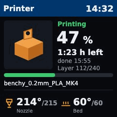
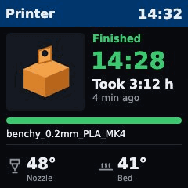
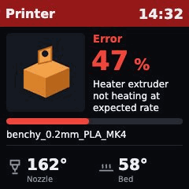
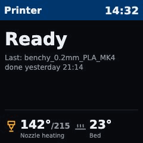

# printer



!!! warning "Noch nicht an einem echten Drucker geprüft"
    Stand 2026-11-25 lief diese Seite nur gegen Antworten, die aus Doku und Quellcode des jeweiligen Systems nachgebaut sind (Fixtures). Von den Quellen lief nur Moonraker gegen einen Simulator (virtual-klipper-printer); gegen einen echten Drucker oder eine Home-Assistant-Instanz lief noch keine. Siehe [Getestet mit](#getestet-mit). Wenn du sie mit deinem Drucker nutzt, schreib bitte in einem [GitHub-Issue](https://github.com/robinlanger/glancebox/issues), was geht und was nicht.

## Was sie zeigt

Einen 3D-Drucker auf einen Blick: druckt er, wie weit ist er, wann ist er fertig, ist etwas schiefgegangen, sind Düse und Bett heiß. Der Zustand kommt entweder direkt vom Drucker (Moonraker für Klipper, OctoPrint, PrusaLink) oder aus den Entitäten des Druckers in [Home Assistant](https://www.home-assistant.io/) (Moonraker, OctoPrint, PrusaLink, Bambu Lab, Creality oder eigene Entitäten).

| | |
| --- | --- |
| { width="240" } | { width="240" } |
| { width="240" } | { width="240" } |

Die Bilder rendert der Server mit Beispieldaten (auf Englisch); das Slicer-Vorschaubild darin ist eine eigene Zeichnung.

- **Druckt** (grün): Prozent, Balken, Restzeit (`noch 1:23 h`), Fertig-Uhrzeit (`fertig 15:55`, mit Wochentag, wenn es nicht heute ist), Schicht (`Schicht 112/240`), wo die Quelle sie kennt, Dateiname ohne Pfad und Endung und das Vorschaubild des Slicers, wo es eins gibt. Ohne Bild steht die Prozentzahl groß links.
- **Pausiert** (orange): dasselbe, die Restzeit grau, weil sie steht, und `seit 14:05`, wo die Quelle sagt, seit wann.
- **Fertig** (grün): die Uhrzeit des Endes groß, `Dauer 3:12 h` und `vor 4 min`, Balken voll.
- **Fehler** (roter Kopf): Fortschritt in Rot und die Meldung des Druckers in bis zu drei Zeilen, wo die Quelle eine liefert.
- **Bereit**: `Bereit` groß, `Zuletzt: <Datei>` und `fertig <Zeit>`, wenn der letzte Druck bekannt ist.
- **Drucker nicht erreichbar** (grau, kein Alarm): ein ausgeschalteter Drucker ist normal.
- Unten Düse und Bett: Symbol orange und `214°/215`, solange die Heizung an ist, grau und nur der Ist-Wert, wenn sie aus ist; `Düse heizt`, solange sie mehr als 5 °C unter ihrem Ziel liegt.

**Fertig** bleibt `finished_for` Minuten (Standard 120) nach dem Ende des Drucks stehen, danach zeigt die Seite **Bereit** mit dem Druck als `Zuletzt:`. Klipper bleibt auf `complete` und Bambu Lab auf `finish`, bis der nächste Druck beginnt; sonst stünde tagelang „Fertig“ da. Wo die Quelle nicht sagt, wann der Druck geendet hat (OctoPrint, PrusaLink, Moonraker ohne seine History-Komponente), zählt die Seite ab dem Moment, an dem sie „Fertig“ zuerst gesehen hat; nach einem Neustart des Servers beginnt diese Frist neu.

Jedes Feld, das die Quelle nicht liefert (Bild, Schicht, Soll-Temperatur, Restzeit), fällt einfach weg; Pflicht ist nur der Zustand.

Grenzen:

- Nur Werkzeug 0 (die erste Düse, bei Klipper `extruder`). IDEX, Werkzeugwechsler und die zweite Düse eines XL werden nicht gezeigt.
- Kein Webcam-Bild, nur das Slicer-Vorschaubild der Datei.
- Die Seite liest nur. Sie kann einen Druck nicht pausieren oder abbrechen.
- Bambu Lab und Creality nur über Home Assistant, nicht direkt.
- OctoPrint und PrusaLink liefern keine Schicht. OctoPrint 1.x liefert ein Vorschaubild nur mit dem Plugin [Slicer Thumbnails](https://plugins.octoprint.org/plugins/prusaslicerthumbnails/) (Repository OctoPrint-PrusaSlicerThumbnails).
- Elegoo, Anycubic, Snapmaker, Duet und andere haben keine Vorlage: nimm Home Assistant mit `integration: custom` und deinen eigenen Entitäten.

## Was du brauchst

- **Direkt vom Drucker:** die Adresse von Moonraker (Klipper, meist Port 7125), OctoPrint oder PrusaLink, erreichbar vom Glance-Box-Server, und deren API-Key oder Passwort (siehe [Einrichtung](#einrichtung)).
- **Über Home Assistant:** die Integration deines Druckers in Home Assistant und, bei Docker, `HA_URL` und `HA_TOKEN` in der `.env` wie bei der [Seite homeassistant](homeassistant.md#was-du-brauchst). Im [Home-Assistant-Add-on](../home-assistant.md) brauchst du beides nicht.

## Beispiel

Moonraker (Klipper) direkt:

```yaml
- type: printer
  source: moonraker
  url: http://drucker.local:7125
  # api_key: ${MOONRAKER_KEY}     # nur, wenn Moonraker der Adresse des Servers nicht vertraut
```

OctoPrint direkt:

```yaml
- type: printer
  source: octoprint
  url: http://drucker.local
  api_key: ${OCTOPRINT_KEY}
```

PrusaLink direkt (MK4, XL, Mini, MK3.9, Core One):

```yaml
- type: printer
  source: prusalink
  url: http://drucker.local
  password: ${PRUSALINK_PASSWORD}  # Benutzer ist maker, außer du setzt user:
```

Über Home Assistant (Docker):

```yaml
- type: printer
  source: hass
  url: ${HA_URL}
  token: ${HA_TOKEN}
  integration: moonraker
  device: voron
```

Im Home-Assistant-Add-on `url` und `token` weglassen:

```yaml
- type: printer
  source: hass
  integration: bambu_lab
  device: x1c_0000000000          # Entitäts-Präfix deines Druckers, siehe Einrichtung
  title: Bambu
```

Keys und Passwörter gehören nie in die `config.yaml`. Bei Docker kommen sie in die `.env` (`OCTOPRINT_KEY=...`), danach `docker compose up -d`. Im Add-on trägst du sie im Tab Konfiguration unter **Weitere Geheimnisse** (`extra_secrets`) mit demselben Namen ein.

## Optionen

| Schlüssel | Standard | Bedeutung |
| --- | --- | --- |
| `source` | | `moonraker`, `octoprint`, `prusalink` oder `hass`. Pflicht. |
| `url` | | Adresse des Druckers (Moonraker meist `http://drucker.local:7125`) oder, bei `hass`, von Home Assistant. Beginnt mit `http://` oder `https://`. Pflicht, außer bei `hass` im Add-on. |
| `api_key` | | `moonraker`: optional, wird als `X-Api-Key` geschickt. `octoprint`: Pflicht. `prusalink`: statt `password`, wenn du am Drucker einen API-Key eingerichtet hast. Immer als `${NAME}` aus der `.env`. |
| `password` | | `prusalink`: das PrusaLink-Passwort aus dem Menü des Druckers (HTTP Digest). Entweder `password` oder `api_key`. |
| `user` | `maker` | `prusalink`: Benutzer zum Passwort. Nur zusammen mit `password`. |
| `token` | | `hass`: langlebiger Zugangstoken. Pflicht, außer im Add-on. Als `${HA_TOKEN}`. |
| `integration` | | `hass`: `moonraker`, `octoprint`, `prusalink`, `bambu_lab`, `creality` oder `custom`. Pflicht. |
| `device` | | `hass`: das Entitäts-Präfix deines Druckers, zum Beispiel `voron` für `sensor.voron_progress`. Pflicht, außer bei `octoprint` (Standard `octoprint`); ohne Wirkung bei `custom`. Kleinbuchstaben, Ziffern und `_`. |
| `entities` | | `hass`: ersetzt einzelne Entitäten der Vorlage, siehe unten. Bei `custom` Pflicht, mindestens `state`. |
| `states` | | `hass`: zusätzliche rohe Zustandswörter je Zustand, siehe unten. |
| `title` | `Drucker` / `Printer` | Text der Kopfzeile. |
| `thumbnail` | `true` | `false` zeigt nie das Slicer-Vorschaubild. |
| `finished_for` | `120` | Minuten, die **Fertig** nach dem Ende eines Drucks stehen bleibt, danach **Bereit**. `0` zeigt nie **Fertig**. |
| `lang` | `lang` der obersten Ebene | `de` oder `en`. |
| `refresh` | `10` | Sekunden zwischen zwei Abfragen. **Mindestens 5.** Die Seite fragt den Drucker (oder Home Assistant) bei jedem Refresh, auch während eine andere Seite auf dem Display ist; ein unverändertes Bild wird nicht noch einmal geschickt. |
| `duration` | `interval` | Wie viele Sekunden die Seite auf dem Display bleibt. |

Die Seite nimmt nur die Schlüssel ihrer `source` an (dazu `title`, `thumbnail`, `finished_for`, `lang`, `refresh`, `duration`); ein Schlüssel einer anderen Quelle, etwa `password` bei `source: octoprint`, stoppt den Server mit einer Meldung, die die erlaubten Schlüssel nennt.

**Vorlagen für Home Assistant:**

| `integration` | Integration | Woher | Restzeit | Schicht | Bild |
| --- | --- | --- | --- | --- | --- |
| `moonraker` | [Moonraker](https://github.com/marcolivierarsenault/moonraker-home-assistant) | HACS | ja | ja | ja, nur während des Drucks |
| `octoprint` | [OctoPrint](https://www.home-assistant.io/integrations/octoprint/) | Home Assistant Core | aus der Fertig-Uhrzeit | nein | nein (nur die Webcam) |
| `prusalink` | [PrusaLink](https://www.home-assistant.io/integrations/prusalink/) | Home Assistant Core | aus der Fertig-Uhrzeit | nein | ja |
| `bambu_lab` | [Bambu Lab](https://github.com/greghesp/ha-bambulab) | HACS | ja | ja | ja |
| `creality` | [Creality](https://github.com/3dg1luk43/ha_creality_ws) | HACS | ja | ja | ja |
| `custom` | beliebig | | was du einträgst | was du einträgst | was du einträgst |

Feldnamen von `entities:` und die Entität der Vorlage bei `device: voron` (`<d>`):

| Feld | Bedeutung | Vorlage `moonraker` |
| --- | --- | --- |
| `state` | Zustand des Druckers (Pflicht) | `sensor.<d>_current_print_state` |
| `progress` | Fortschritt in % | `sensor.<d>_progress` |
| `remaining` | Restzeit; braucht eine Einheit `s`, `min`, `h` oder `d` | `sensor.<d>_print_time_left` |
| `eta` | Fertig-Uhrzeit (Zeitstempel) | `sensor.<d>_print_eta` |
| `filename` | Dateiname | `sensor.<d>_filename` |
| `nozzle`, `nozzle_target` | Düsentemperatur und Ziel | `sensor.<d>_extruder_temperature`, `number.<d>_extruder_target` |
| `bed`, `bed_target` | Betttemperatur und Ziel | `sensor.<d>_bed_temperature`, `number.<d>_bed_target` |
| `layer`, `layer_total` | aktuelle Schicht und Gesamtzahl | `sensor.<d>_current_layer`, `sensor.<d>_total_layer` |
| `thumbnail` | Vorschaubild, eine `camera.`- oder `image.`-Entität | `camera.<d>_thumbnail` |

Die Entitäten aller Vorlagen stehen in den [Entwicklernotizen](https://github.com/robinlanger/glancebox/blob/main/pages/printer/README.md#presets) (Englisch). `sensor.name#attribut` liest ein Attribut statt des Zustands, zum Beispiel `nozzle_target: sensor.k1_nozzle_temperature#target`. Eine Entität in `entities:` ersetzt nur dieses Feld; die anderen bleiben bei der Vorlage.

`states:` ordnet rohe Zustandswörter deiner Entität den Zuständen der Seite zu: `printing`, `paused`, `finished`, `error`, `idle` und `offline`. Verglichen wird in Kleinbuchstaben:

```yaml
  states:
    printing: [running, calibrating_extrusion]
    idle: [standby]
```

Diese sechs Wörter zählen immer als sie selbst. Ein Wort, das die Seite nicht kennt, erscheint als **Bereit** mit dem Wort als kleiner Zeile, und das Log nennt es einmal.

Eine andere Marke über Home Assistant, mit `integration: custom`:

```yaml
- type: printer
  source: hass
  integration: custom
  entities:                       # deine eigenen Entity-IDs
    state: sensor.elegoo_print_status
    progress: sensor.elegoo_print_progress
    remaining: sensor.elegoo_time_left
    nozzle: sensor.elegoo_nozzle_temperature
    bed: sensor.elegoo_bed_temperature
  states:
    finished: [complete]
    idle: [standby]
```

## Einrichtung

### Moonraker (Klipper)

Moonraker lässt den Server ohne Key zu, wenn seine Adresse unter `trusted_clients` im Abschnitt `[authorization]` der `moonraker.conf` steht, zum Beispiel das Netz `192.168.x.0/24`. Dann brauchst du kein `api_key`. Sonst lies den API-Key von Moonraker aus, zum Beispiel mit `curl http://drucker.local:7125/access/api_key` von einem vertrauten Rechner, trag ihn als `MOONRAKER_KEY=...` in die `.env` ein und setz `api_key: ${MOONRAKER_KEY}`.

Restzeit, Schicht und Vorschaubild liest die Seite aus den Metadaten der Datei, wie Mainsail und Fluidd. Die Schicht braucht Schicht-Angaben in diesen Metadaten oder `SET_PRINT_STATS_INFO` im G-Code; das Vorschaubild braucht einen Slicer, der eins einbettet (PNG, oder JPEG, wenn es kein PNG gibt). „Zuletzt:“ und die End-Uhrzeit nach einem Druck kommen aus der History von Moonraker (`[history]` in der `moonraker.conf`). Läuft Moonraker, aber Klipper ist nicht verbunden, zeigt die Seite **Drucker nicht erreichbar** mit „Klipper nicht verbunden“.

### OctoPrint

Leg in OctoPrint einen Anwendungsschlüssel an: **Settings → Application Keys** (oder derselbe Abschnitt in deinen Benutzereinstellungen), „Manually generate an application key“, einen Namen wie `glancebox` eintragen und **Generate** klicken. Trag ihn als `OCTOPRINT_KEY=...` in die `.env` ein und setz `api_key: ${OCTOPRINT_KEY}`.

Zum Vorschaubild: OctoPrint 2.x hat eigene Vorschaubilder; OctoPrint 1.x nur mit dem Plugin „Slicer Thumbnails“. Ein Bild gibt es nur für Dateien, die auf OctoPrint liegen, nicht für Drucke von der SD-Karte des Druckers. Hinter einem Reverse Proxy, der OctoPrint unter einem anderen Hostnamen oder Schema als `url` ausliefert, fällt das Bild weg, damit der Key nie an eine andere Adresse geht. OctoPrint hat im Kern keine Druck-History; die Ansicht Bereit zeigt deshalb nur dann „Zuletzt:“, wenn die Seite das Ende des Drucks selbst gesehen hat.

### PrusaLink

Am Drucker unter **Settings → Network → PrusaLink** (englische Menünamen der Buddy-Firmware 8.0.2; auf einem deutsch eingestellten Drucker übersetzt, in anderen Versionen eventuell anders) stehen Benutzer (`maker`) und Passwort. Trag das Passwort als `PRUSALINK_PASSWORD=...` in die `.env` ein und setz `password: ${PRUSALINK_PASSWORD}`. Lässt deine Firmware stattdessen einen API-Key zu, nimm `api_key:`.

Ist ein Druck fertig, vergisst der Drucker den Job. Die Seite merkt sich deshalb den letzten Job, den sie während des Drucks gesehen hat (Dateiname, Dauer, Bild), und zeigt ihn bei **Fertig**; die Dauer kann bis zu einen Refresh zu kurz sein. Startet der Server genau dann neu, zeigt **Fertig** keinen Dateinamen.

### Home Assistant

1. Richte die Integration deines Druckers in Home Assistant ein: Moonraker, Bambu Lab und Creality über [HACS](https://hacs.xyz/), OctoPrint und PrusaLink gehören zu Home Assistant (**Einstellungen → Geräte & Dienste → Integration hinzufügen**). Die Tabelle der Vorlagen unter [Optionen](#optionen) verlinkt jede.
2. Das Präfix für `device:` finden: öffne **Einstellungen → Geräte & Dienste → Entitäten** und suche die Zustands-Entität deiner Integration, zum Beispiel `current_print_state` (Moonraker), `print_status` (Bambu Lab, Creality) oder `progress` (PrusaLink). Das Präfix ist der Teil zwischen `sensor.` und dieser Endung: aus `sensor.voron_current_print_state` wird `device: voron`. Bei PrusaLink ist die Zustands-Entität `sensor.<präfix>` selbst.
   - Bambu Lab nimmt meist Druckertyp und Seriennummer ins Präfix (`x1c_<seriennummer>`).
   - Creality nimmt den Hostnamen des Druckers oder das Modell.
   - OctoPrint braucht kein `device:`: seine Entitäten beginnen mit `octoprint`. Eine zweite OctoPrint-Instanz in Home Assistant bekommt `octoprint_2`, also `device: octoprint_2`.
   - Ein Gerät lässt sich in Home Assistant umbenennen; dann ändert sich auch das Präfix.
3. PrusaLink: die vier Temperatursensoren sind ab Werk **deaktiviert**. Aktiviere sie auf der Geräteseite unter Entitäten, sonst fehlt die Temperaturzeile.
4. Docker: `HA_URL` und `HA_TOKEN` in die `.env` eintragen wie bei der [Seite homeassistant](homeassistant.md#was-du-brauchst). Add-on: `url` und `token` weglassen.

Hinweise: Die Moonraker-Integration liefert ein Vorschaubild nur während des Drucks. Ein Klipper-Shutdown über Home Assistant zeigt **Fehler** ohne Meldung.

Docker und Namen auf `.local`: ein Docker-Container löst sie oft nicht auf. Sagt die Seite **Drucker nicht erreichbar**, obwohl der Drucker an ist, trag stattdessen die Adresse ein, zum Beispiel `http://192.168.x.x:7125`.

## Getestet mit

Stand 2026-11-25. Nichts davon lief bisher gegen einen echten Drucker oder eine Home-Assistant-Instanz; nur Moonraker lief gegen einen Simulator.

| Quelle | Wie geprüft | Stand |
| --- | --- | --- |
| Moonraker direkt | nur mit nachgebauten Antworten (Fixtures) aus Moonraker master b559b9a8, Klipper 7558e8c2, Mainsail ce96e4d7 und Fluidd 8509fc70; Gerätetest steht aus | 2026-11-25 |
| Moonraker-Simulator (virtual-klipper-printer) | per Docker auf einem Mac gegen virtual-klipper-printer e272bcd (Image `sha256:84da96e5`, Moonraker b559b9a, Klipper v0.14.0, simulierte AVR-MCU) mit einer Probedatei im PrusaSlicer-Format. Geprüft: Druckt (Prozent steigt, Restzeit, Fertig-Uhrzeit, Schicht aus Metadaten und Z, Dateiname, Vorschaubild aus `.thumbs`, Temperaturen), pausiert und fortgesetzt, Fertig mit Ende-Uhrzeit und Dauer, `Bereit` mit `Zuletzt:` nach `finished_for` (laufender Server), abgebrochen → `Bereit`, Klippy-Shutdown (Not-Aus; MCU `Timer too close`) → rot mit der Ursache, Druckfehler (`Must home axis first`) → rot mit Fortschritt und Meldung, Klippy startet → `Klipper startet`, Moonraker gestoppt → `Drucker nicht erreichbar` mit einer Logzeile. Daraus kamen zwei Korrekturen: keine Datei-Schätzung der Restzeit vor der ersten Extrusion, und von Klippys Shutdown-Meldung nur die erste Zeile. Gesehen: Während Moonraker selbst startet, antwortet es etwa eine Sekunde lang mit 404; ein Abruf in dem Moment zeigt einmal `Antwort nicht lesbar`. Nicht geprüft: echte Heizkurven (der Simulator misst konstant 103 °C, Sollwerte bleiben 0), der API-Key (der Simulator vertraut jedem Client), eine Schicht aus `SET_PRINT_STATS_INFO`, JPEG-Vorschaubilder, Moonraker ohne History-Komponente, die Antwort 503 (`Klipper nicht verbunden`), eine neu geslicte Datei gleichen Namens bei laufendem Server | 2026-11-25 |
| OctoPrint direkt | nur Fixtures aus Doku und Quellcode von OctoPrint 2.0.2 und dem Plugin Slicer Thumbnails (OctoPrint-PrusaSlicerThumbnails) 1.2.4 | 2026-11-25 |
| OctoPrint-Simulator (Virtual Printer, 1.11.8) | noch nicht gelaufen | 2026-11-25 |
| PrusaLink direkt | nur Fixtures aus Doku und Quellcode von Prusa-Firmware-Buddy v8.0.2 und der OpenAPI-Beschreibung von Prusa-Link-Web | 2026-11-25 |
| Home Assistant `moonraker` | nur Fixtures aus Doku und Quellcode von moonraker-home-assistant v1.14.0 | 2026-11-25 |
| Home Assistant `octoprint` | nur Fixtures aus Doku und Quellcode von Home Assistant Core (dev, `components/octoprint` 5f380806) | 2026-11-25 |
| Home Assistant `prusalink` | nur Fixtures aus Doku und Quellcode von Home Assistant Core (dev, `components/prusalink` 8dbdb49d) | 2026-11-25 |
| Home Assistant `bambu_lab` | nur Fixtures aus Doku und Quellcode von ha-bambulab v2.4.1 | 2026-11-25 |
| Home Assistant `creality` | nur Fixtures aus Doku und Quellcode von ha_creality_ws v0.9.10 | 2026-11-25 |

„Nur Fixtures“ heißt: Die Tests der Seite füttern sie mit Antworten, die von Hand aus Doku und Quellcode dieser Version nachgebaut sind. Ob ein echter Drucker oder eine echte Integration so antwortet, ist nicht geprüft. Wenn du eine davon betreibst, schreib bitte in einem [GitHub-Issue](https://github.com/robinlanger/glancebox/issues), was funktioniert hat, mit der Version deiner Firmware oder Integration.

## Wenn etwas nicht stimmt

- **`Drucker nicht erreichbar`:** Drucker oder sein Rechner ist aus, Adresse oder Port stimmen nicht, oder der Container löst einen Namen auf `.local` nicht auf (trag stattdessen die Adresse `http://192.168.x.x:7125` ein). Bei Moonraker mit „Klipper nicht verbunden“: Moonraker läuft, Klipper nicht; prüfe Klipper in Mainsail oder Fluidd.
- **`Zugang abgelehnt`** mit `API-Key prüfen` oder `Passwort prüfen`: der Drucker hat Key oder Passwort abgelehnt. Moonraker: steht die Adresse des Servers unter `trusted_clients`, oder ist der Key aktuell? OctoPrint: gibt es den Anwendungsschlüssel noch? PrusaLink: Passwort und Benutzer aus dem Menü des Druckers.
- **`Token abgelehnt`, `Keine Verbindung zu Home Assistant`:** dieselben Ursachen und Abhilfen wie bei der [Seite homeassistant](homeassistant.md#wenn-etwas-nicht-stimmt).
- **`Entität fehlt: sensor.…`:** die Zustands-Entität der Vorlage gibt es nicht. Prüfe `device:` gegen die Entitätenliste in Home Assistant (siehe [Einrichtung](#home-assistant)) und die `integration:`. Fehlt die Entität eines anderen Felds, fällt nur dieses Feld weg.
- **`Antwort nicht lesbar`:** unter der Adresse antwortet etwas, aber nicht die Drucker-API, die die Seite erwartet. Prüfe `source:` und den Port in `url`.
- **Eine kleine Zeile mit unbekanntem Wort unter `Bereit`:** deine Integration meldet ein Zustandswort, das die Vorlage nicht kennt. Trag es unter `states:` ein, zum Beispiel `states: {printing: [calibrating]}`.
- **Kein Vorschaubild:** der Slicer schreibt keins in die Datei (PrusaSlicer: Printer Settings → General → Firmware → G-code thumbnails, sichtbar im Expertenmodus, zum Beispiel `300x300/PNG`; OrcaSlicer: die Option „G-code thumbnails“ in den Druckereinstellungen), OctoPrint 1.x hat das Plugin „Slicer Thumbnails“ nicht, die Datei wurde von der SD-Karte gedruckt, das Bild ist weder PNG noch JPEG (PrusaLink schickt eventuell QOI) oder größer als 512 KiB, oder `thumbnail: false` ist gesetzt. Über Home Assistant: die Integration hat keine Bild-Entität (OctoPrint) oder liefert sie nur während des Drucks (Moonraker).
- **Keine Restzeit:** die Quelle hat in dem Moment keine (Moonraker ohne Slicer-Schätzung erst ab 1 % Fortschritt und der ersten Extrusion), der Home-Assistant-Sensor hat keine Einheit (`s`, `min`, `h`, `d`) oder ist deaktiviert, oder die Fertig-Uhrzeit liegt in der Vergangenheit.
- **Keine Temperaturen:** PrusaLink über Home Assistant: die Temperatursensoren aktivieren (siehe [Einrichtung](#home-assistant)).
- **„Fertig“ bleibt zu lange oder zu kurz:** setz `finished_for` (Minuten; `0` zeigt nie „Fertig“).
- **Der Server startet nicht und nennt eine Option dieser Seite:** die Meldung nennt die Stelle und was falsch ist, zum Beispiel ein Schlüssel einer anderen Quelle, fehlendes `api_key` bei OctoPrint, `password` und `api_key` zugleich bei PrusaLink, fehlendes `device` bei `hass` oder `refresh` unter 5.
