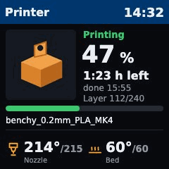

# Template catalog

Ready-made pages for the display. Each one has its own page with an example picture, all options, setup steps and notes on privacy. Add a page to the `pages:` list in `config.yaml` and restart the server, see [Server configuration](../configuration.md).

## Time & weather

### clock

A large clock with weekday and date, and the starting point for your own pages. [Details](clock.md)

### weather

Current weather and the next four hours for one place, from the free Open-Meteo service. [Details](weather.md)

## Server & smart home

### kuma

State of an Uptime Kuma status page: all green, or which services are down and since when. [Details](kuma.md)

### homeassistant

Live values of up to six Home Assistant entities as large tiles or a list: solar power, temperatures, open windows, lights. Needs a long-lived access token. [Details](homeassistant.md)

### energy

Energy flow from Home Assistant in up to four rows (grid, PV, battery, gas, water, wallbox), with arrows that move on the display in the direction of the flow (firmware 0.7.0 or newer). [Details](energy.md)

## 3D printing

### printer

State, progress, time left, finish time, slicer preview and temperatures of one 3D printer, directly from Moonraker (Klipper), OctoPrint or PrusaLink, or through Home Assistant (also Bambu Lab and Creality). Checked on a real printer only through Moonraker (Klipper), directly and through Home Assistant. [Details](printer.md)

## AI & development

### ai

How much of your AI plan or budget you have used. Provider `claude`: the 5-hour and weekly limits of your Claude plan, sent by Claude Code's status line. `anthropic-api`, `openai-api`, `xai-api`: API cost of the month or the prepaid balance. `copilot`: GitHub Copilot usage against your plan's allowance. [Details](ai.md)

## Transport

### bahn

Live departures for a German station with delays, platform changes and cancellations. [Details](bahn.md)

## Your own pages

Pages are a folder with a small Python file and a Jinja template. [Writing pages](../writing-pages.md) walks you through it.
