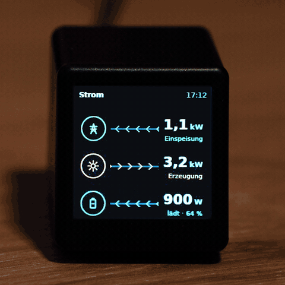

# energy


On the real display, filmed with a camera (only the black of the screen darkened afterwards):

{ width="360" }

## What it shows

Where energy flows in your home, from [Home Assistant](https://www.home-assistant.io/): one to four rows, each with an icon, a track with moving arrows, the value and a short status line. Typical rows are grid, PV and battery on one page, gas, water and wallbox on another. You can add as many `energy` pages as you like.

The arrows say which way it flows:

| Arrows | Meaning | Rows |
| --- | --- | --- |
| away from the icon (to the right) | this source supplies the home | grid import, PV, battery discharging, gas, water |
| towards the icon (to the left) | this row takes energy | grid export, battery charging, wallbox |
| none, grey track and value | nothing flows | value 0, below `min`, `n/a` or `missing` |

The more power or flow, the faster the arrows: from 10 px/s for small values up to 80 px/s from the row's `full` value on. The value is shown without a sign; direction, colour and status line (`Import`, `Export`, `Producing`, `charging`, `discharging`, `Usage`) tell you which way. With a `soc` sensor the battery row also shows its level, for example `charging · 64 %`.

Each row type expects its sensor in this form:

| `type` | Sensor | Sign | `full` default |
| --- | --- | --- | --- |
| `grid` | power, W or kW | positive = import from the grid, negative = export to the grid | 5000 W |
| `pv` | power, W or kW | positive = producing; negative counts as 0 | 5000 W |
| `battery` | power, W or kW | positive = discharging, negative = charging (as in the Home Assistant energy dashboard) | 3000 W |
| `gas` | flow, for example m³/h | positive = usage; negative counts as 0 | 2 (sensor unit) |
| `water` | flow, for example L/min | positive = usage; negative counts as 0 | 15 (sensor unit) |
| `wallbox` | power, W or kW | positive = charging the car; negative counts as 0 | 11000 W |

If your sensor reports the other way round, `invert: true` flips the sign. Values in W from 1000 on are shown as kW. Like on the `homeassistant` page, a sensor that is `unavailable` or `unknown` shows `n/a`, a sensor that does not exist shows `missing`, and without a connection the page shows `Cannot reach Home Assistant` with the time of the last attempt, never old values.

Honest notes:

- Power sensors usually update about once a second. **Gas and water meters often report only pulses or every few minutes**, so their arrows react late.
- The page needs a sensor for the **flow or the power**, not the meter reading. If you only have a meter reading (m³, kWh), create a **Derivative** helper in Home Assistant (Settings → Devices & services → Helpers) and use that.
- From the sensor to the display takes several seconds (Home Assistant, the server's refresh, the display fetching the picture). The arrows show direction and order of magnitude, not every short peak.
- **The arrows run from firmware 0.7.0 on.** With older firmware the page shows as a still picture with empty tracks. The preview in the browser (overview page, add-on web UI) is always a still picture.

## What you need

- A running Home Assistant that the Glance Box server can reach over the network, and a long-lived access token, set up as for the [homeassistant page](homeassistant.md#what-you-need). In the [Home Assistant add-on](../home-assistant.md) you need neither.
- The entity ids of your power and flow sensors, for example `sensor.grid_power`. You find them in Home Assistant under **Settings → Devices & services → Entities**. The sensors of the energy dashboard (Settings → Dashboards → Energy) are a good start.
- For the arrows: the display (GeekMagic SmallTV Ultra) on firmware 0.7.0 or newer. The version is shown at the top of the device page.

No sensors yet, or want to try the arrows first? The [simulated Home Assistant](https://github.com/robinlanger/glancebox/tree/main/tools/ha-sim) in the repository has fake energy sensors with sliders (`tools/ha-sim/config/packages/energy.yaml`, works in any Home Assistant with packages).

## Example

Grid, PV and battery:

```yaml
- type: energy
  url: ${HA_URL}              # leave out in the add-on
  token: ${HA_TOKEN}          # leave out in the add-on
  title: Power
  refresh: 5
  rows:
    - type: grid
      entity: sensor.grid_power
      # invert: true          # if your meter reports export as positive
      # full: 5000            # value for full speed
      # min: 20               # below this the row counts as 0
    - type: pv
      entity: sensor.pv_power
    - type: battery
      entity: sensor.battery_power
      soc: sensor.battery_level   # optional, level in %
```

Gas, water and wallbox on a second page:

```yaml
- type: energy
  url: ${HA_URL}
  token: ${HA_TOKEN}
  title: House
  refresh: 5
  rows:
    - type: gas
      entity: sensor.gas_flow
    - type: water
      entity: sensor.water_flow
    - type: wallbox
      entity: sensor.wallbox_power
```

## Options

| Key | Default | Meaning |
| --- | --- | --- |
| `url` | | Address of your Home Assistant, starting with `http://` or `https://`, without `/api`. Required, except in the add-on. Best as `${HA_URL}` from `.env`. |
| `token` | | Long-lived access token. Required, except in the add-on. Always as `${HA_TOKEN}` from `.env`, never written into `config.yaml`. |
| `rows` | | List of 1 to 4 rows. Required. The same type may appear more than once (two PV systems). |
| `rows[].type` | | `grid`, `pv`, `battery`, `gas`, `water` or `wallbox`. Required. |
| `rows[].entity` | | Entity id of the power or flow sensor, like `sensor.grid_power`. Required. |
| `rows[].soc` | | Only for `battery`: entity id of the battery level in %. Shown in the status line. |
| `rows[].invert` | `false` | `true` flips the sign of the sensor. |
| `rows[].full` | see the row type table | Value at which the arrows reach full speed. In W for `grid`, `pv`, `battery` and `wallbox` (also if the sensor reports kW), in the sensor's unit for `gas` and `water`. Must be above 0. |
| `rows[].min` | `0` | Absolute values below this count as 0: grey, no arrows. Same unit as `full`. |
| `title` | `Energy` | Header text. |
| `animate` | `true` | `false` sends no arrows; the display shows a still picture. |
| `lang` | top-level `lang` | `de` or `en`. Sets all texts and the number format. |
| `refresh` | `5` | Seconds between two requests to Home Assistant. **At least 2.** The page asks Home Assistant once per sensor on each refresh, also while another page is on the display. |
| `duration` | `interval` | How many seconds the page stays on the display. |

A row only accepts the keys above; a typo such as `inverted` stops the server with a message.

## Setup

1. Docker: put `HA_URL` and `HA_TOKEN` in `.env` as described for the [homeassistant page](homeassistant.md#what-you-need). Add-on: skip this step.
2. Add one of the examples to the `pages:` list in `config.yaml` with your entity ids. In the add-on, leave out `url` and `token`.
3. Docker: run `docker compose up -d`. Add-on: restart the add-on.
4. Open the overview (`http://<server>:8080/` or the add-on web UI) and check the still picture: values, colours and status lines.
5. Watch the display: the arrows should match what your energy dashboard in Home Assistant shows. If a direction is wrong, see below.

## When something is wrong

- **Arrows run the wrong way** (export shows as import, charging as discharging): your sensor uses the other sign. Set `invert: true` on that row.
- **Arrows too fast or too slow:** set `full` to about the largest value you usually see. A smaller `full` makes small values faster.
- **Arrows creep at night** (a few watts from a meter or inverter): set `min`, for example `min: 20`. A power sensor in kW with very small values (such as `0.04 kW`) shows `0 kW` and the row stays grey anyway.
- **Separate sensors for import and export** (or for charging and discharging): the page needs one sensor with a sign. Create a template sensor in Home Assistant, for example `{{ states('sensor.grid_import') | float(0) - states('sensor.grid_export') | float(0) }}`, and use that.
- **Gas or water row stays grey or reacts late:** check that the entity is a flow (m³/h, L/min) and not the meter reading. Many gas and water meters report only every few minutes.
- **No arrows at all:** check the firmware version at the top of the device page; arrows need 0.7.0 or newer. Check that the page has no `animate: false`. A row without flow has no arrows by design.
- **`Cannot reach Home Assistant`, `Token rejected`, `missing`, `n/a`:** the same causes and fixes as on the [homeassistant page](homeassistant.md#when-something-is-wrong).
- **The server refuses to start and names an option of this page:** the message names the place and what is wrong. `rows` needs 1 to 4 entries; `type` must be one of the six row types; `entity` must look like `sensor.name`; `soc` is only allowed for `battery`; `invert` and `animate` must be `true` or `false`; `full` must be a number above 0, `min` a number of at least 0; `refresh` must be at least 2.
