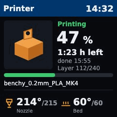
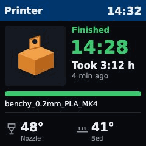
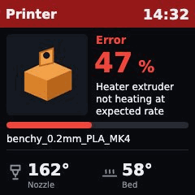
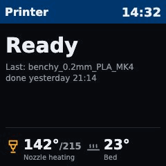

# printer



!!! warning "Checked on a real printer only with Klipper"
    As of 2026-11-27 this page has run on a real printer only through Moonraker: directly and through the Home Assistant Moonraker integration, on a Creality Ender 5 with its own Klipper firmware. All other sources and integrations have only run against answers rebuilt from the documentation and source code of each system (fixtures); OctoPrint has also run against its Virtual Printer (1.11.8 and 2.0.2), not on a real printer. See [Tested with](#tested-with). If you use it with your printer, please report what works and what does not in a [GitHub issue](https://github.com/robinlanger/glancebox/issues).

## What it shows

One 3D printer at a glance: is it printing, how far along, when it will be done, did something go wrong, are nozzle and bed hot. The status comes either directly from the printer (Moonraker for Klipper, OctoPrint, PrusaLink) or from the printer's entities in [Home Assistant](https://www.home-assistant.io/) (Moonraker, OctoPrint, PrusaLink, Bambu Lab, Creality, or your own entities).

| | |
| --- | --- |
| { width="240" } | { width="240" } |
| { width="240" } | { width="240" } |

The pictures are rendered by the server with sample data; the slicer preview in them is a drawing of our own.

- **Printing** (green): percentage, bar, time left (`1:23 h left`), finish time (`done 15:55`, with the weekday if it is not today), layer (`Layer 112/240`) where the source knows it, file name without path and extension, and the slicer's preview picture of the file where there is one. Without a picture the percentage is shown large on the left.
- **Paused** (orange): the same, the time left in grey because it stands still, and `since 14:05` where the source tells when it paused.
- **Finished** (green): the time it ended, large, `Took 3:12 h` and `4 min ago`, full bar.
- **Error** (red header): progress in red and the printer's message in up to three lines, where the source gives one.
- **Ready**: `Ready` large, `Last: <file>` and `done <time>` when the last print is known.
- **Printer not reachable** (grey, no alarm): a printer that is switched off is normal.
- **Printer off** (grey, no alarm): Moonraker runs (directly or through the Home Assistant Moonraker integration), but Klipper has lost its printer board ("Lost communication with MCU"), which is what Klipper reports when the printer is switched off and its host keeps running. Below it `Last: <file>` when the last print finished successfully. Klipper no longer updates the temperatures then, so none are shown.
- At the bottom nozzle and bed: icon orange and `214°/215` while the heater is on, grey with only the current value when it is off; `Nozzle heating` while it is more than 5 °C below its target.

**Finished** stays for `finished_for` minutes (default 120) after the end of the print, then the page shows **Ready** with the print as `Last:`. Klipper stays at `complete` and Bambu Lab at `finish` until the next print starts, so the page would otherwise show "Finished" for days. Where the source does not tell when the print ended (OctoPrint, PrusaLink, Moonraker without its history component), the page counts from when it first saw "Finished"; after a restart of the server that period starts again.

Any field the source does not give (picture, layer, target temperature, time left) is simply left out; only the state is required.

Limits:

- Only tool 0 (the first nozzle, Klipper's `extruder`). IDEX, toolchangers and the second nozzle of an XL are not shown.
- No webcam picture, only the slicer's preview of the file.
- The page only reads. It cannot pause or cancel a print.
- Bambu Lab and Creality only through Home Assistant, not directly.
- OctoPrint and PrusaLink give no layer. OctoPrint 1.x gives a preview picture only with the plugin [Slicer Thumbnails](https://plugins.octoprint.org/plugins/prusaslicerthumbnails/) (repository OctoPrint-PrusaSlicerThumbnails).
- Elegoo, Anycubic, Snapmaker, Duet and others have no preset: use Home Assistant with `integration: custom` and your own entities.

## What you need

- **Directly from the printer:** the address of Moonraker (Klipper, usually port 7125), OctoPrint or PrusaLink, reachable from the Glance Box server, and its API key or password (see [Setup](#setup)).
- **Through Home Assistant:** the integration of your printer set up in Home Assistant, and, for Docker, `HA_URL` and `HA_TOKEN` in `.env` as for the [homeassistant page](homeassistant.md#what-you-need). In the [Home Assistant add-on](../home-assistant.md) you need neither.

## Example

Moonraker (Klipper) directly:

```yaml
- type: printer
  source: moonraker
  url: http://drucker.local:7125
  # api_key: ${MOONRAKER_KEY}     # only if Moonraker does not trust the server's address
```

OctoPrint directly:

```yaml
- type: printer
  source: octoprint
  url: http://drucker.local
  api_key: ${OCTOPRINT_KEY}
```

PrusaLink directly (MK4, XL, Mini, MK3.9, Core One):

```yaml
- type: printer
  source: prusalink
  url: http://drucker.local
  password: ${PRUSALINK_PASSWORD}  # user is maker unless you set user:
```

Through Home Assistant (Docker):

```yaml
- type: printer
  source: hass
  url: ${HA_URL}
  token: ${HA_TOKEN}
  integration: moonraker
  device: voron
```

In the Home Assistant add-on, leave out `url` and `token`:

```yaml
- type: printer
  source: hass
  integration: bambu_lab
  device: x1c_0000000000          # your printer's entity prefix, see Setup
  title: Bambu
```

Keys and passwords never go into `config.yaml`. With Docker put them in `.env` (`OCTOPRINT_KEY=...`) and run `docker compose up -d`. In the add-on add them on the Configuration tab under **More secrets** (`extra_secrets`) with the same name.

## Options

| Key | Default | Meaning |
| --- | --- | --- |
| `source` | | `moonraker`, `octoprint`, `prusalink` or `hass`. Required. |
| `url` | | Address of the printer (Moonraker usually `http://drucker.local:7125`) or, with `hass`, of Home Assistant. Starts with `http://` or `https://`. Required, except with `hass` in the add-on. |
| `api_key` | | `moonraker`: optional, sent as `X-Api-Key`. `octoprint`: required. `prusalink`: instead of `password`, if you set up an API key on the printer. Always as `${NAME}` from `.env`. |
| `password` | | `prusalink`: the PrusaLink password from the printer's menu (HTTP Digest). Either `password` or `api_key`. |
| `user` | `maker` | `prusalink`: user for the password. Only together with `password`. |
| `token` | | `hass`: long-lived access token. Required, except in the add-on. As `${HA_TOKEN}`. |
| `integration` | | `hass`: `moonraker`, `octoprint`, `prusalink`, `bambu_lab`, `creality` or `custom`. Required. |
| `device` | | `hass`: the entity prefix of your printer, for example `voron` for `sensor.voron_progress`. Required, except for `octoprint` (default `octoprint`); no effect with `custom`. Lower case letters, digits and `_`. |
| `entities` | | `hass`: replaces single entities of the preset, see below. With `custom` required, at least `state`. |
| `states` | | `hass`: extra raw state words per state, see below. |
| `title` | `Drucker` / `Printer` | Header text. |
| `thumbnail` | `true` | `false` never shows the slicer preview. |
| `finished_for` | `120` | Minutes **Finished** stays after the end of a print, then **Ready**. `0` never shows **Finished**. |
| `lang` | top-level `lang` | `de` or `en`. |
| `refresh` | `10` | Seconds between two requests. **At least 5.** The page asks the printer (or Home Assistant) on each refresh, also while another page is on the display; an unchanged picture is not sent again. |
| `duration` | `interval` | How many seconds the page stays on the display. |
| `time_format` | top-level `time_format` | `24h` or `12h`. With `12h` the finish time, "since" and the end of the last print read `4:47 PM`. A time on another day shows the weekday (`Tue 9:14 PM`) instead of "yesterday", and more than 6 days away only the date (`Nov 10`). Time left, duration and "4 min ago" stay as they are. |

The page only accepts the keys of its `source` (plus `title`, `thumbnail`, `finished_for`, `lang`, `refresh`, `duration`, `time_format`); a key of another source, such as `password` with `source: octoprint`, stops the server with a message that lists the allowed keys.

**Home Assistant presets:**

| `integration` | Integration | From | Time left | Layer | Picture |
| --- | --- | --- | --- | --- | --- |
| `moonraker` | [Moonraker](https://github.com/marcolivierarsenault/moonraker-home-assistant) | HACS | yes | yes | yes, only while printing |
| `octoprint` | [OctoPrint](https://www.home-assistant.io/integrations/octoprint/) | Home Assistant core | from the finish time | no | no (only the webcam) |
| `prusalink` | [PrusaLink](https://www.home-assistant.io/integrations/prusalink/) | Home Assistant core | from the finish time | no | yes |
| `bambu_lab` | [Bambu Lab](https://github.com/greghesp/ha-bambulab) | HACS | yes | yes | yes |
| `creality` | [Creality](https://github.com/3dg1luk43/ha_creality_ws) | HACS | yes | yes | yes |
| `custom` | any | | what you list | what you list | what you list |

Field names of `entities:` and the preset's entity for `device: voron` (`<d>`):

| Field | Meaning | `moonraker` preset |
| --- | --- | --- |
| `state` | printer state (required) | `sensor.<d>_current_print_state` |
| `progress` | progress in % | `sensor.<d>_progress` |
| `remaining` | time left; needs a unit `s`, `min`, `h` or `d` | `sensor.<d>_print_time_left` |
| `eta` | finish time (timestamp) | `sensor.<d>_print_eta` |
| `filename` | file name | `sensor.<d>_filename` |
| `nozzle`, `nozzle_target` | nozzle temperature and target | `sensor.<d>_extruder_temperature`, `number.<d>_extruder_target` |
| `bed`, `bed_target` | bed temperature and target | `sensor.<d>_bed_temperature`, `number.<d>_bed_target` |
| `layer`, `layer_total` | current and total layer | `sensor.<d>_current_layer`, `sensor.<d>_total_layer` |
| `thumbnail` | preview picture, a `camera.` or `image.` entity | `camera.<d>_thumbnail` |

The entities of all presets are listed in the [developer notes](https://github.com/robinlanger/glancebox/blob/main/pages/printer/README.md#presets). `sensor.name#attribute` reads an attribute instead of the state, for example `nozzle_target: sensor.k1_nozzle_temperature#target`. An entity in `entities:` replaces only that field; the others keep the preset.

`states:` adds raw state words of your entity to the page's states `printing`, `paused`, `finished`, `error`, `idle` and `offline`. Words are compared in lower case:

```yaml
  states:
    printing: [running, calibrating_extrusion]
    idle: [standby]
```

Those six words always count as themselves. A word the page does not know shows as **Ready** with the word as a small line, and the log names it once.

Another brand through Home Assistant, with `integration: custom`:

```yaml
- type: printer
  source: hass
  integration: custom
  entities:                       # your own entity ids
    state: sensor.elegoo_print_status
    progress: sensor.elegoo_print_progress
    remaining: sensor.elegoo_time_left
    nozzle: sensor.elegoo_nozzle_temperature
    bed: sensor.elegoo_bed_temperature
  states:
    finished: [complete]
    idle: [standby]
```

## Setup

### Moonraker (Klipper)

Moonraker accepts the server if its address is in `trusted_clients` in the `[authorization]` section of `moonraker.conf`, for example the network `192.168.x.0/24`. Then you need no `api_key`. Otherwise read Moonraker's API key, for example with `curl http://drucker.local:7125/access/api_key` from a trusted computer, put it in `.env` as `MOONRAKER_KEY=...` and set `api_key: ${MOONRAKER_KEY}`.

The page reads the time left, layer and preview picture from the file's metadata, as Mainsail and Fluidd do. The layer needs layer information in that metadata or `SET_PRINT_STATS_INFO` in the G-code; the preview needs a slicer that embeds a thumbnail (PNG, or JPEG if there is no PNG). "Last:" and the end time after a print come from Moonraker's history (`[history]` in `moonraker.conf`); "Last:" names only a print that finished successfully, after a cancelled or failed print it is not shown. If Moonraker runs but Klipper is not connected, the page shows **Printer not reachable** with "Klipper not connected". If Klipper runs but has lost its printer board (printer switched off), it shows **Printer off**; any other Klipper shutdown shows **Error** in red with its cause.

### OctoPrint

Create an application key in OctoPrint: **Settings → Application Keys** (or the same section in your user settings), "Manually generate an application key", enter a name such as `glancebox` and click **Generate**. Put it in `.env` as `OCTOPRINT_KEY=...` and set `api_key: ${OCTOPRINT_KEY}`.

The preview picture: OctoPrint 2.x has thumbnails of its own; OctoPrint 1.x only with the plugin "Slicer Thumbnails". Only files stored on OctoPrint get a picture, not files printed from the printer's SD card. Behind a reverse proxy that gives OctoPrint another host name or scheme than `url`, the picture is left out, so the key is never sent to another address. OctoPrint has no print history in its core, so the Ready view shows no "Last:" unless the page saw the print finish itself.

### PrusaLink

On the printer, open **Settings → Network → PrusaLink** (menu names of the Buddy firmware 8.0.2 in English; other versions or languages may differ): it shows the user (`maker`) and the password. Put the password in `.env` as `PRUSALINK_PASSWORD=...` and set `password: ${PRUSALINK_PASSWORD}`. If your firmware lets you set an API key instead, use `api_key:`.

When a print has finished, the printer forgets the job. The page therefore remembers the last job it saw while printing (file name, duration, picture) and shows it on **Finished**; the duration can be up to one refresh short. After a restart of the server at that moment, **Finished** shows without a file name.

### Home Assistant

1. Set up the integration of your printer in Home Assistant: Moonraker, Bambu Lab and Creality from [HACS](https://hacs.xyz/), OctoPrint and PrusaLink are part of Home Assistant (**Settings → Devices & services → Add integration**). The presets table under [Options](#options) links each one.
2. Find the prefix for `device:`: open **Settings → Devices & services → Entities** and search for the state entity of your integration, for example `current_print_state` (Moonraker), `print_status` (Bambu Lab, Creality) or `progress` (PrusaLink). The prefix is the part between `sensor.` and that ending: `sensor.voron_current_print_state` gives `device: voron`. For PrusaLink the state entity is `sensor.<prefix>` itself.
   - Bambu Lab usually puts the printer type and serial number into the prefix (`x1c_<serial>`).
   - Creality uses the printer's host name, or the model.
   - OctoPrint needs no `device:`: its entities start with `octoprint`. A second OctoPrint instance in Home Assistant gets `octoprint_2`, so set `device: octoprint_2`.
   - You can rename a device in Home Assistant; then the prefix changes too.
3. PrusaLink: the four temperature sensors are **disabled** by default. Enable them on the device page under Entities, otherwise the temperature line is missing.
4. Docker: put `HA_URL` and `HA_TOKEN` in `.env` as for the [homeassistant page](homeassistant.md#what-you-need). Add-on: leave out `url` and `token`.

Notes: the Moonraker integration gives a preview picture only while printing. The integration passes on Klipper's message (`sensor.<device>_printer_message`) and the message of a failed print (`sensor.<device>_current_print_message`), so through Home Assistant a switched-off printer shows **Printer off** as well, with `Last: <file>` while the integration still reports the last print as complete (after a cancelled or failed print there is no "Last:"); any other Klipper shutdown shows **Error** in red with its cause and without temperatures. Whenever Klipper is not printing, a pause included, the integration reports progress, time left and layer as 0; the page therefore shows these values only while printing, and a paused print shows only file, temperatures and "since …". While heating the integration reports a time left of 0, so below 1 % the page shows the slicer's estimate (`sensor.<device>_slicer_print_time_left_estimate`), as with Moonraker directly. From 1 % the time left comes from the integration; it calculates differently from Mainsail, and the direct and Home Assistant values converge during the print. At a layer change the layer can be one lower than in Mainsail and with Moonraker directly (seen: 13/15 against 14/15): the integration calculates it from the physical height of the toolhead and rounds down, Mainsail from the Z height in the G-code and rounds up. On the test printer a change of state arrived through Home Assistant about 30–35 s later than directly, measured once (switched off after about 35 s; after a Klipper restart about 30 s of **Printer not reachable**, then **Ready**); this is an observation, not a fixed time.

Docker and names ending in `.local`: a Docker container often cannot resolve them. If the page says **Printer not reachable** while the printer is on, enter the address instead, for example `http://192.168.x.x:7125`.

## Tested with

As of 2026-11-27. Only Moonraker has run on a real printer, directly and through the Home Assistant Moonraker integration (rows "Moonraker directly" and "Home Assistant `moonraker`"). All other sources and integrations have run only with fixtures; Moonraker and OctoPrint have also run against simulators.

| Source | How it was checked | As of |
| --- | --- | --- |
| Moonraker directly | on a real printer: Creality Ender 5 with its own Klipper firmware (Klipper, Moonraker and Mainsail in Docker through prind), Moonraker without API key (trusted client), test prints from OrcaSlicer with an embedded preview picture, among them a 17-minute print. Also fixtures from Moonraker master b559b9a8, Klipper 7558e8c2, Mainsail ce96e4d7 and Fluidd 8509fc70. Checked: printer switched off while its host keeps running (Klipper shutdown "Lost communication with MCU") → grey `Printer off` without temperatures, `Last:` only if the newest history job finished successfully; print error from Klipper (`BLTouch failed to raise probe`) → red `Error` with that message, preview picture and file name; after switching on `Ready` with temperatures; heating at the start → `Printing 0 %`, time left from the slicer's estimate, nozzle and bed `heating` with target; printing: percentage relative to the file (Klipper's raw 14 % shown as 10 %, as in Mainsail), time left (mean of slicer and file estimate), finish time, layer from Z (2/10, 14/15), preview picture from OrcaSlicer; cancelled → `Ready` without `Last:` (the last job did not finish); finished → `Finished <time>`, `Took 21 min` (total including heating), `just now`, preview picture; after `finished_for` (3 for the test) → `Ready`, `Last: <file>`, `done <time>`. One fix came from it: a switched-off printer shows `Printer off` instead of red `Error` with frozen temperatures. Not checked: a real pause and resume (only in the simulator), `Klipper not connected` (Moonraker runs, Klipper does not), API key and reverse proxy, Fluidd as frontend (only Mainsail ran) | 2026-11-27 |
| Moonraker simulator (virtual-klipper-printer) | ran in Docker on a Mac against virtual-klipper-printer e272bcd (image `sha256:84da96e5`, Moonraker b559b9a, Klipper v0.14.0, simulated AVR MCU) with a probe file in PrusaSlicer format. Checked: printing (percentage rising, time left, finish time, layer from metadata and Z, file name, preview picture from `.thumbs`, temperatures), paused and resumed, finished with end time and duration, `Ready` with `Last:` after `finished_for` (running server), cancelled → `Ready`, Klippy shutdown (emergency stop; MCU `Timer too close`) → red with the cause, print error (`Must home axis first`) → red with progress and message, Klippy starting → `Klipper is starting`, Moonraker stopped → `Printer not reachable` with one log line. Two fixes came from it: no file-based time left before the first extrusion, and only the first line of Klippy's shutdown message. Seen: while Moonraker itself starts it answers 404 for about a second; a refresh at that moment shows `Unexpected answer` once. Not checked: real heating curves (the simulator reads a constant 103 °C, targets stay 0), the API key (the simulator trusts every client), a layer from `SET_PRINT_STATS_INFO`, JPEG previews, Moonraker without the history component, the 503 answer (`Klipper not connected`), a file sliced again under the same name while the server runs | 2026-11-25 |
| OctoPrint directly | only fixtures from the documentation and source code of OctoPrint 2.0.2 and the Slicer Thumbnails plugin (OctoPrint-PrusaSlicerThumbnails) 1.2.4 | 2026-11-25 |
| OctoPrint simulator (Virtual Printer, 1.11.8) | ran in Docker on a Mac against the image `octoprint/octoprint:1.11.8` (`sha256:5ea0181e`) with OctoPrint's Virtual Printer and the probe file of the Moonraker run, without plugins. Checked: not connected → `Printer not reachable` (HTTP 409), connected → `Ready` with temperatures, printing (percentage, time left, finish time, file name, nozzle `heating`, no layer, no picture without plugin), pausing and paused → `Paused`, resumed → `Printing`, finished at 100 % → `Finished` with duration, `Ready` with `Last:` after `finished_for` (running server), cancelling and cancelled → `Ready`, firmware error (the Virtual Printer's simulated thermal runaway) → red with the cause, both while `/api/printer` still answers with the error flags and after it answers 409 (`Offline after error`), disconnected → `Printer not reachable`, wrong key → `Access denied` (HTTP 403, no key in the log line). No fix was needed. Not checked: a print from the SD card, real heating curves, a reverse proxy | 2026-11-25 |
| OctoPrint 1.11.8 with Slicer Thumbnails 1.2.4 | same container with the plugin added: the file answer carries `thumbnail` (`plugin/prusaslicerthumbnails/thumbnail/<name>.png?<timestamp>`), the page shows the picture while printing and when finished; the picture needs the API key, which the page sends. Seen: the plugin 1.2.4 asks for Pillow 13 or newer, which needs Python 3.11; the image has Python 3.10, so a plain `pip install` of 1.2.4 fails. For this run it was installed with `--no-deps` next to Pillow 12.3.0 | 2026-11-25 |
| OctoPrint 2.0.2 (Virtual Printer) | ran on a Mac from PyPI (Python 3.12) with the Virtual Printer and the same probe file. Checked: printing with the preview picture from OctoPrint's own thumbnails (`refs.thumbnail`, needs and gets the API key), paused, resumed, finished with duration, cancelled → `Ready`, disconnected → `Printer not reachable`, wrong key → `Access denied`, firmware error → red `Error`. Seen: after a firmware error OctoPrint 2.0.2 closes the connection and its API no longer carries the error text (`/api/job` `error` is `null`), so the page shows `Error` without the cause. Not checked on 2.0.2: `Ready` with `Last:` after `finished_for`, a print from the SD card | 2026-11-25 |
| PrusaLink directly | only fixtures from the documentation and source code of Prusa-Firmware-Buddy v8.0.2 and the Prusa-Link-Web OpenAPI description | 2026-11-25 |
| Home Assistant `moonraker` | on the same real printer: Home Assistant 2026.11.2 (test instance) with moonraker-home-assistant 1.14.0, installed by hand into `custom_components`, without HACS. Also fixtures from the documentation and source code of moonraker-home-assistant v1.14.0. Checked: switched off → `Printer off`, about 35 s after the direct source; Klipper restart → entities `unavailable` for about 30 s → `Printer not reachable`, then `Ready`; print error → red `Error` with Klipper's message, without preview picture (the integration's picture exists only while printing); heating at the start → time left from the slicer's estimate (`17 min left`); printing: percentage as directly, preview picture, layer; the time left converges with the direct one (1 %: 1:25 against 1:42 h, 5 %: 1:18 against 1:27 h, 17 %: 1:09 against 1:10 h, 89 %: both 1 min); cancelled → `Ready`; finished → `Finished <time>`, `just now`, without duration and without preview picture (the integration empties them); after `finished_for` → `Ready`, `Last: <file>`, `done <time>`. Seen: at a layer change the layer can be one lower than directly (13/15 against 14/15), a property of the integration (see the notes above). Three fixes came from it: switched off shows `Printer off`; while heating the integration reports a time left of 0, so below 1 % the slicer's estimate; in a pause (seen in the pause of the cancel macro) it reports progress, time left and layer as 0, so the page shows them only while printing. Not checked: a real pause and resume, installing through HACS | 2026-11-27 |
| Home Assistant `octoprint` | only fixtures from the documentation and source code of Home Assistant core (dev, `components/octoprint` 5f380806) | 2026-11-25 |
| Home Assistant `prusalink` | only fixtures from the documentation and source code of Home Assistant core (dev, `components/prusalink` 8dbdb49d) | 2026-11-25 |
| Home Assistant `bambu_lab` | only fixtures from the documentation and source code of ha-bambulab v2.4.1 | 2026-11-25 |
| Home Assistant `creality` | only fixtures from the documentation and source code of ha_creality_ws v0.9.10 | 2026-11-25 |

"Only fixtures" means: the page's tests feed it answers rebuilt by hand from the documentation and source code of that version. Whether a real printer or integration answers that way is not checked. If you run one of them, please tell us in a [GitHub issue](https://github.com/robinlanger/glancebox/issues) what worked, with the version of your firmware or integration.

## When something is wrong

- **`Printer not reachable`:** the printer or its host is off, the address or port is wrong, or the container cannot resolve a `.local` name (enter the address `http://192.168.x.x:7125` instead). For Moonraker with "Klipper not connected": Moonraker runs, but Klipper does not; check Klipper in Mainsail or Fluidd.
- **`Printer off` although the printer is on:** Klipper has lost the connection to the printer board (USB cable, power of the board). Once the printer is on, run `FIRMWARE_RESTART` in Mainsail or Fluidd; the page follows on its next refresh.
- **`Access denied`** with `Check the API key` or `Check the password`: the printer refused the key or password. Moonraker: is the server's address in `trusted_clients`, or is the key current? OctoPrint: is the application key still there? PrusaLink: password and user from the printer's menu.
- **`Token rejected`, `Cannot reach Home Assistant`:** the same causes and fixes as on the [homeassistant page](homeassistant.md#when-something-is-wrong).
- **`Entity missing: sensor.…`:** the state entity of the preset does not exist. Check `device:` against the entity list in Home Assistant (see [Setup](#home-assistant)) and the `integration:`. A missing entity of another field only leaves that field out.
- **`Unexpected answer`:** the address answers, but not like the printer API the page expects. Check `source:` and the port in `url`.
- **A small line with an unknown word under `Ready`:** your integration reports a state word the preset does not know. Add it under `states:`, for example `states: {printing: [calibrating]}`.
- **No preview picture:** the slicer writes none into the file (PrusaSlicer: Printer Settings → General → Firmware → G-code thumbnails, visible in expert mode, for example `300x300/PNG`; OrcaSlicer: the option "G-code thumbnails" in the printer settings), OctoPrint 1.x has no "Slicer Thumbnails" plugin, the file was printed from the SD card, the picture is neither PNG nor JPEG (PrusaLink may send QOI) or larger than 512 KiB, or `thumbnail: false` is set. Through Home Assistant: the integration has no picture entity (OctoPrint), or gives it only while printing (Moonraker).
- **No time left:** the source has none at that moment (Moonraker: the slicer estimate counts only until the print has taken that long, the estimate from the file only from 1 % progress and the first extrusion on), the Home Assistant sensor has no unit (`s`, `min`, `h`, `d`) or is disabled, or the finish time lies in the past.
- **No temperatures:** PrusaLink through Home Assistant: enable the temperature sensors (see [Setup](#home-assistant)).
- **"Finished" stays too long or not long enough:** set `finished_for` (minutes; `0` never shows "Finished").
- **The server refuses to start and names an option of this page:** the message names the place and what is wrong, for example a key of another source, `api_key` missing for OctoPrint, both `password` and `api_key` for PrusaLink, `device` missing for `hass`, or `refresh` below 5.
